
Recorded decision outcomes · 2000–2025
One year, one picture. Each ring divides that year's decisions into four outcomes; the centre shows the included decision count. Only source records whose four outcomes reconcile to their recorded total are included; coverage is shown on each card.

::: {.annual-pie-grid}

<section class="annual-pie-card" aria-label="Decision outcomes in 2000">
<h3>2000</h3>
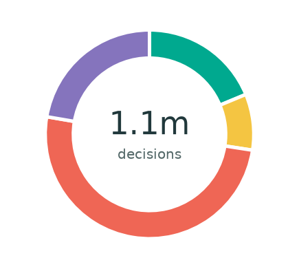
<ul><li><i style="background:#00a98f"></i>Refugee status<strong>19%</strong></li><li><i style="background:#f4c542"></i>Other protection<strong>8.7%</strong></li><li><i style="background:#ef6655"></i>Rejected<strong>50%</strong></li><li><i style="background:#8574bd"></i>Otherwise closed<strong>22%</strong></li></ul>

1,076,202 decisions included of 1,090,296 reported (99%)

</section>

<section class="annual-pie-card" aria-label="Decision outcomes in 2001">
<h3>2001</h3>
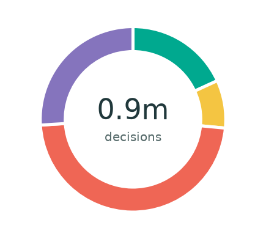
<ul><li><i style="background:#00a98f"></i>Refugee status<strong>18%</strong></li><li><i style="background:#f4c542"></i>Other protection<strong>8.4%</strong></li><li><i style="background:#ef6655"></i>Rejected<strong>48%</strong></li><li><i style="background:#8574bd"></i>Otherwise closed<strong>26%</strong></li></ul>

927,283 decisions included of 946,486 reported (98%)

</section>

<section class="annual-pie-card" aria-label="Decision outcomes in 2002">
<h3>2002</h3>
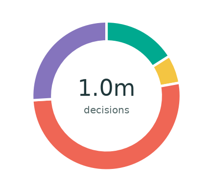
<ul><li><i style="background:#00a98f"></i>Refugee status<strong>16%</strong></li><li><i style="background:#f4c542"></i>Other protection<strong>6.2%</strong></li><li><i style="background:#ef6655"></i>Rejected<strong>52%</strong></li><li><i style="background:#8574bd"></i>Otherwise closed<strong>26%</strong></li></ul>

1,005,992 decisions included of 1,010,251 reported (100%)

</section>

<section class="annual-pie-card" aria-label="Decision outcomes in 2003">
<h3>2003</h3>
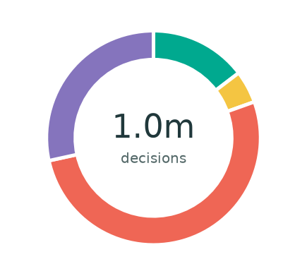
<ul><li><i style="background:#00a98f"></i>Refugee status<strong>15%</strong></li><li><i style="background:#f4c542"></i>Other protection<strong>4.9%</strong></li><li><i style="background:#ef6655"></i>Rejected<strong>52%</strong></li><li><i style="background:#8574bd"></i>Otherwise closed<strong>28%</strong></li></ul>

998,490 decisions included of 1,002,084 reported (100%)

</section>

<section class="annual-pie-card" aria-label="Decision outcomes in 2004">
<h3>2004</h3>
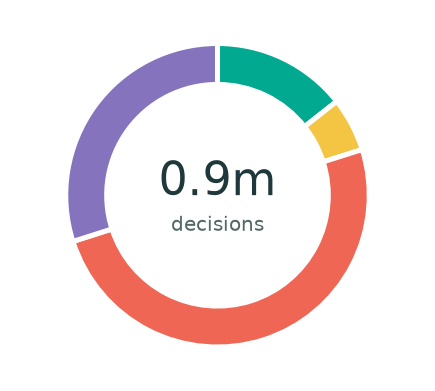
<ul><li><i style="background:#00a98f"></i>Refugee status<strong>14%</strong></li><li><i style="background:#f4c542"></i>Other protection<strong>5.7%</strong></li><li><i style="background:#ef6655"></i>Rejected<strong>50%</strong></li><li><i style="background:#8574bd"></i>Otherwise closed<strong>30%</strong></li></ul>

891,116 decisions included of 891,175 reported (100%)

</section>

<section class="annual-pie-card" aria-label="Decision outcomes in 2005">
<h3>2005</h3>
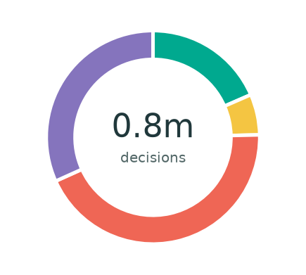
<ul><li><i style="background:#00a98f"></i>Refugee status<strong>18%</strong></li><li><i style="background:#f4c542"></i>Other protection<strong>6.2%</strong></li><li><i style="background:#ef6655"></i>Rejected<strong>44%</strong></li><li><i style="background:#8574bd"></i>Otherwise closed<strong>32%</strong></li></ul>

829,228 decisions included of 829,228 reported (100%)

</section>

<section class="annual-pie-card" aria-label="Decision outcomes in 2006">
<h3>2006</h3>
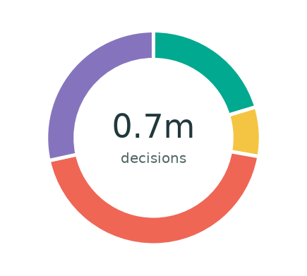
<ul><li><i style="background:#00a98f"></i>Refugee status<strong>20%</strong></li><li><i style="background:#f4c542"></i>Other protection<strong>7.5%</strong></li><li><i style="background:#ef6655"></i>Rejected<strong>44%</strong></li><li><i style="background:#8574bd"></i>Otherwise closed<strong>28%</strong></li></ul>

679,851 decisions included of 692,537 reported (98%)

</section>

<section class="annual-pie-card" aria-label="Decision outcomes in 2007">
<h3>2007</h3>
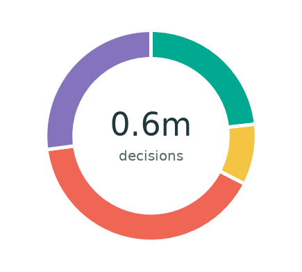
<ul><li><i style="background:#00a98f"></i>Refugee status<strong>23%</strong></li><li><i style="background:#f4c542"></i>Other protection<strong>9.3%</strong></li><li><i style="background:#ef6655"></i>Rejected<strong>40%</strong></li><li><i style="background:#8574bd"></i>Otherwise closed<strong>27%</strong></li></ul>

642,729 decisions included of 644,001 reported (100%)

</section>

<section class="annual-pie-card" aria-label="Decision outcomes in 2008">
<h3>2008</h3>
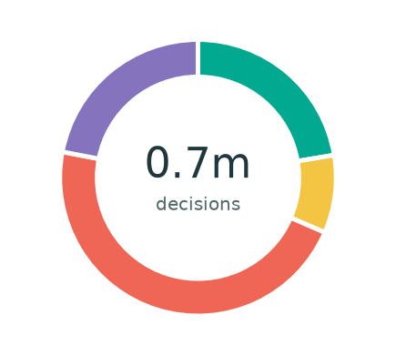
<ul><li><i style="background:#00a98f"></i>Refugee status<strong>22%</strong></li><li><i style="background:#f4c542"></i>Other protection<strong>9.1%</strong></li><li><i style="background:#ef6655"></i>Rejected<strong>47%</strong></li><li><i style="background:#8574bd"></i>Otherwise closed<strong>22%</strong></li></ul>

697,502 decisions included of 706,269 reported (99%)

</section>

<section class="annual-pie-card" aria-label="Decision outcomes in 2009">
<h3>2009</h3>
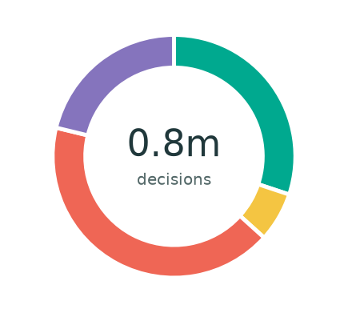
<ul><li><i style="background:#00a98f"></i>Refugee status<strong>30%</strong></li><li><i style="background:#f4c542"></i>Other protection<strong>6.6%</strong></li><li><i style="background:#ef6655"></i>Rejected<strong>42%</strong></li><li><i style="background:#8574bd"></i>Otherwise closed<strong>21%</strong></li></ul>

760,868 decisions included of 762,119 reported (100%)

</section>

<section class="annual-pie-card" aria-label="Decision outcomes in 2010">
<h3>2010</h3>
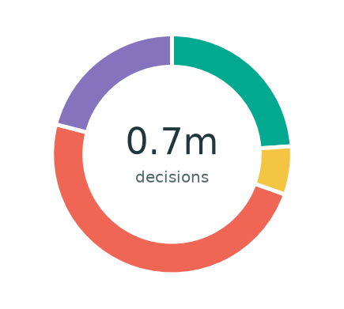
<ul><li><i style="background:#00a98f"></i>Refugee status<strong>24%</strong></li><li><i style="background:#f4c542"></i>Other protection<strong>6.5%</strong></li><li><i style="background:#ef6655"></i>Rejected<strong>49%</strong></li><li><i style="background:#8574bd"></i>Otherwise closed<strong>21%</strong></li></ul>

727,845 decisions included of 730,596 reported (100%)

</section>

<section class="annual-pie-card" aria-label="Decision outcomes in 2011">
<h3>2011</h3>
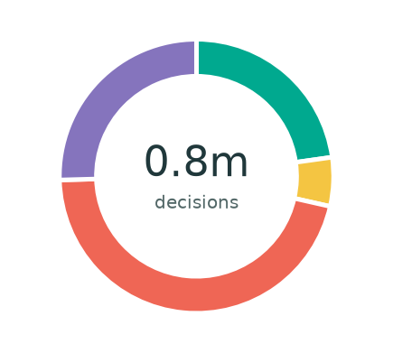
<ul><li><i style="background:#00a98f"></i>Refugee status<strong>23%</strong></li><li><i style="background:#f4c542"></i>Other protection<strong>5.8%</strong></li><li><i style="background:#ef6655"></i>Rejected<strong>46%</strong></li><li><i style="background:#8574bd"></i>Otherwise closed<strong>25%</strong></li></ul>

754,172 decisions included of 768,675 reported (98%)

</section>

<section class="annual-pie-card" aria-label="Decision outcomes in 2012">
<h3>2012</h3>
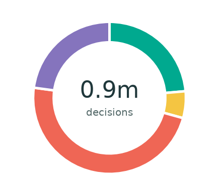
<ul><li><i style="background:#00a98f"></i>Refugee status<strong>24%</strong></li><li><i style="background:#f4c542"></i>Other protection<strong>5.7%</strong></li><li><i style="background:#ef6655"></i>Rejected<strong>48%</strong></li><li><i style="background:#8574bd"></i>Otherwise closed<strong>23%</strong></li></ul>

893,398 decisions included of 913,275 reported (98%)

</section>

<section class="annual-pie-card" aria-label="Decision outcomes in 2013">
<h3>2013</h3>
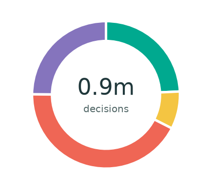
<ul><li><i style="background:#00a98f"></i>Refugee status<strong>24%</strong></li><li><i style="background:#f4c542"></i>Other protection<strong>8.2%</strong></li><li><i style="background:#ef6655"></i>Rejected<strong>43%</strong></li><li><i style="background:#8574bd"></i>Otherwise closed<strong>25%</strong></li></ul>

880,516 decisions included of 880,516 reported (100%)

</section>

<section class="annual-pie-card" aria-label="Decision outcomes in 2014">
<h3>2014</h3>
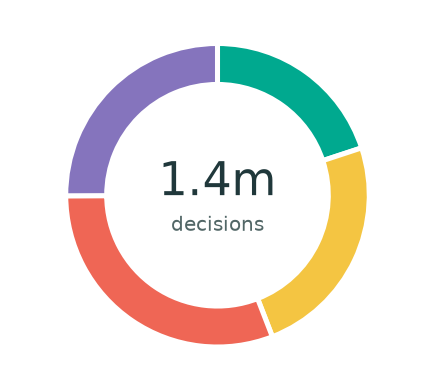
<ul><li><i style="background:#00a98f"></i>Refugee status<strong>20%</strong></li><li><i style="background:#f4c542"></i>Other protection<strong>24%</strong></li><li><i style="background:#ef6655"></i>Rejected<strong>31%</strong></li><li><i style="background:#8574bd"></i>Otherwise closed<strong>25%</strong></li></ul>

1,393,642 decisions included of 1,393,642 reported (100%)

</section>

<section class="annual-pie-card" aria-label="Decision outcomes in 2015">
<h3>2015</h3>
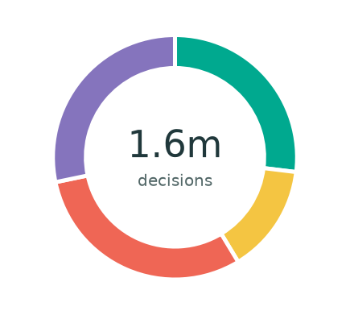
<ul><li><i style="background:#00a98f"></i>Refugee status<strong>27%</strong></li><li><i style="background:#f4c542"></i>Other protection<strong>14%</strong></li><li><i style="background:#ef6655"></i>Rejected<strong>30%</strong></li><li><i style="background:#8574bd"></i>Otherwise closed<strong>28%</strong></li></ul>

1,647,628 decisions included of 1,647,628 reported (100%)

</section>

<section class="annual-pie-card" aria-label="Decision outcomes in 2016">
<h3>2016</h3>
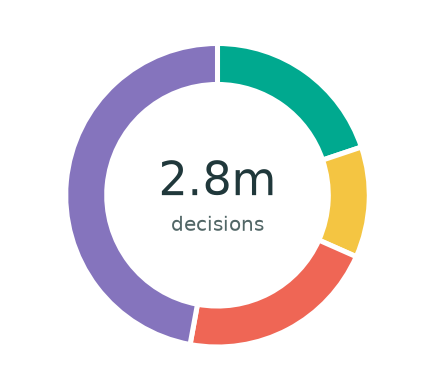
<ul><li><i style="background:#00a98f"></i>Refugee status<strong>20%</strong></li><li><i style="background:#f4c542"></i>Other protection<strong>12%</strong></li><li><i style="background:#ef6655"></i>Rejected<strong>21%</strong></li><li><i style="background:#8574bd"></i>Otherwise closed<strong>47%</strong></li></ul>

2,844,805 decisions included of 2,844,805 reported (100%)

</section>

<section class="annual-pie-card" aria-label="Decision outcomes in 2017">
<h3>2017</h3>
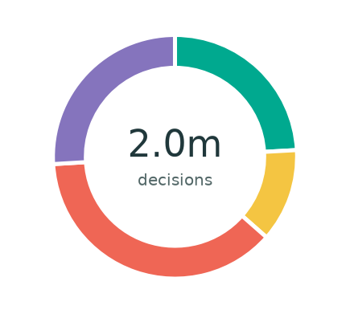
<ul><li><i style="background:#00a98f"></i>Refugee status<strong>24%</strong></li><li><i style="background:#f4c542"></i>Other protection<strong>12%</strong></li><li><i style="background:#ef6655"></i>Rejected<strong>38%</strong></li><li><i style="background:#8574bd"></i>Otherwise closed<strong>26%</strong></li></ul>

2,006,176 decisions included of 2,006,176 reported (100%)

</section>

<section class="annual-pie-card" aria-label="Decision outcomes in 2018">
<h3>2018</h3>
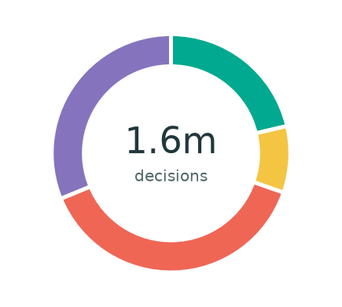
<ul><li><i style="background:#00a98f"></i>Refugee status<strong>21%</strong></li><li><i style="background:#f4c542"></i>Other protection<strong>9.0%</strong></li><li><i style="background:#ef6655"></i>Rejected<strong>38%</strong></li><li><i style="background:#8574bd"></i>Otherwise closed<strong>31%</strong></li></ul>

1,646,871 decisions included of 1,647,261 reported (100%)

</section>

<section class="annual-pie-card" aria-label="Decision outcomes in 2019">
<h3>2019</h3>
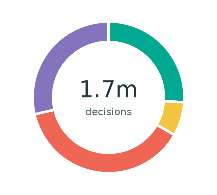
<ul><li><i style="background:#00a98f"></i>Refugee status<strong>26%</strong></li><li><i style="background:#f4c542"></i>Other protection<strong>7.2%</strong></li><li><i style="background:#ef6655"></i>Rejected<strong>38%</strong></li><li><i style="background:#8574bd"></i>Otherwise closed<strong>29%</strong></li></ul>

1,715,050 decisions included of 1,730,880 reported (99%)

</section>

<section class="annual-pie-card" aria-label="Decision outcomes in 2020">
<h3>2020</h3>
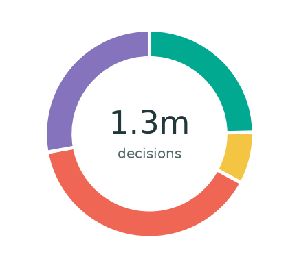
<ul><li><i style="background:#00a98f"></i>Refugee status<strong>25%</strong></li><li><i style="background:#f4c542"></i>Other protection<strong>8.1%</strong></li><li><i style="background:#ef6655"></i>Rejected<strong>39%</strong></li><li><i style="background:#8574bd"></i>Otherwise closed<strong>28%</strong></li></ul>

1,349,286 decisions included of 1,381,088 reported (98%)

</section>

<section class="annual-pie-card" aria-label="Decision outcomes in 2021">
<h3>2021</h3>
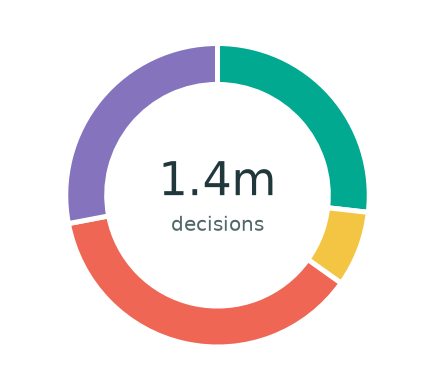
<ul><li><i style="background:#00a98f"></i>Refugee status<strong>27%</strong></li><li><i style="background:#f4c542"></i>Other protection<strong>8.0%</strong></li><li><i style="background:#ef6655"></i>Rejected<strong>37%</strong></li><li><i style="background:#8574bd"></i>Otherwise closed<strong>28%</strong></li></ul>

1,422,047 decisions included of 1,422,047 reported (100%)

</section>

<section class="annual-pie-card" aria-label="Decision outcomes in 2022">
<h3>2022</h3>
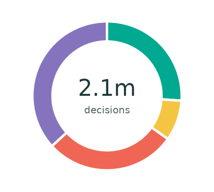
<ul><li><i style="background:#00a98f"></i>Refugee status<strong>26%</strong></li><li><i style="background:#f4c542"></i>Other protection<strong>8.8%</strong></li><li><i style="background:#ef6655"></i>Rejected<strong>28%</strong></li><li><i style="background:#8574bd"></i>Otherwise closed<strong>37%</strong></li></ul>

2,057,838 decisions included of 2,057,838 reported (100%)

</section>

<section class="annual-pie-card" aria-label="Decision outcomes in 2023">
<h3>2023</h3>
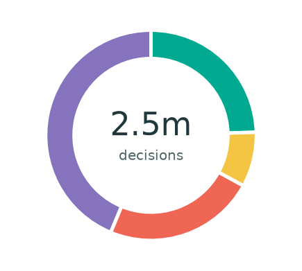
<ul><li><i style="background:#00a98f"></i>Refugee status<strong>25%</strong></li><li><i style="background:#f4c542"></i>Other protection<strong>8.4%</strong></li><li><i style="background:#ef6655"></i>Rejected<strong>23%</strong></li><li><i style="background:#8574bd"></i>Otherwise closed<strong>44%</strong></li></ul>

2,498,303 decisions included of 2,498,303 reported (100%)

</section>

<section class="annual-pie-card" aria-label="Decision outcomes in 2024">
<h3>2024</h3>
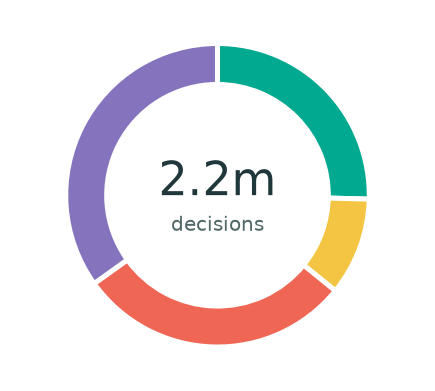
<ul><li><i style="background:#00a98f"></i>Refugee status<strong>25%</strong></li><li><i style="background:#f4c542"></i>Other protection<strong>10%</strong></li><li><i style="background:#ef6655"></i>Rejected<strong>29%</strong></li><li><i style="background:#8574bd"></i>Otherwise closed<strong>35%</strong></li></ul>

2,164,386 decisions included of 2,164,386 reported (100%)

</section>

<section class="annual-pie-card" aria-label="Decision outcomes in 2025">
<h3>2025</h3>
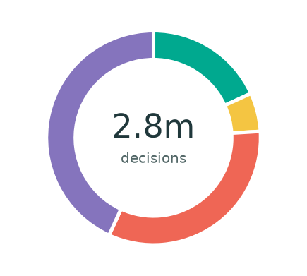
<ul><li><i style="background:#00a98f"></i>Refugee status<strong>18%</strong></li><li><i style="background:#f4c542"></i>Other protection<strong>5.8%</strong></li><li><i style="background:#ef6655"></i>Rejected<strong>33%</strong></li><li><i style="background:#8574bd"></i>Otherwise closed<strong>43%</strong></li></ul>

2,836,187 decisions included of 2,836,187 reported (100%)

</section>

:::

Each percentage uses **all decisions in the included, reconciled records for that year**, including administrative closures. Source records with missing outcomes, inconsistent totals, or no positive decision total are excluded; the inclusion percentage compares eligible decision totals with all reported decision totals. The headline application and decision totals still use the full extract. Original persons- and case-reported counts are combined without conversion. Rounded percentages may not sum to 100%. Coverage and procedure mix can change between years; these are not application-cohort success rates.

[Download annual decision counts and unrounded shares (CSV)](data/annual-decision-outcomes.csv)
