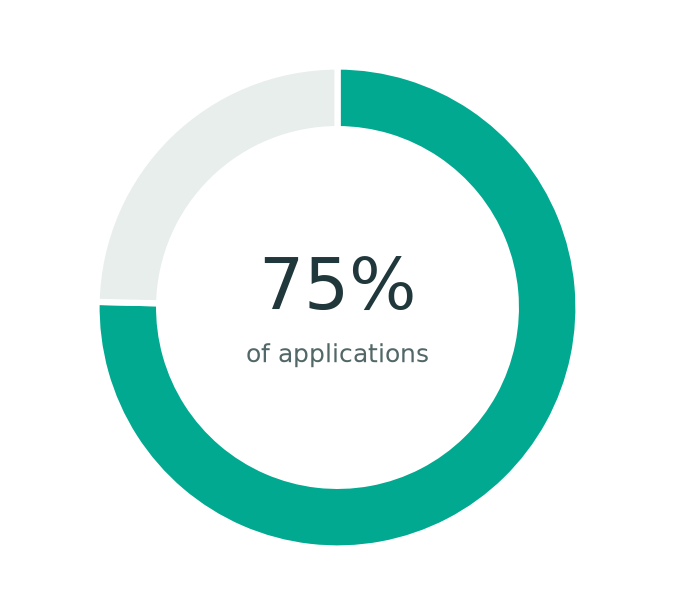
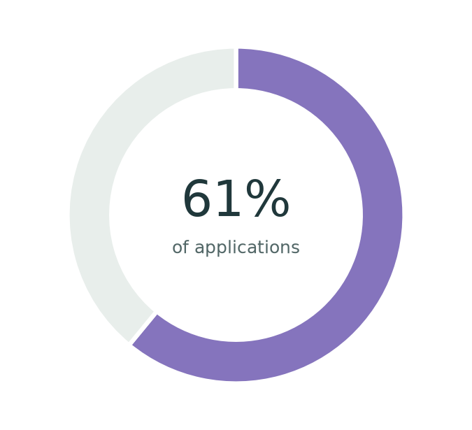

## Where are applications concentrated? {#concentration}

**40,727,399 reported applications worldwide, 2000–2025.** The two pies describe the same recorded application total from different perspectives: where applications were received and where they originated.

:::: {.headline-concentration}
::: {.concentration-card}
### Top 20 receiving countries

**30.7 million applications**

{fig-alt="Pie comparing 30,697,110 applications for the Top 20 with 10,030,289 for all others, 2000 to 2025."}

<i style="background:#00a98f"></i>Top 20 <strong>30,697,110 · 75%</strong><i style="background:#e8eeeb"></i>All others <strong>10,030,289 · 25%</strong>

:::

::: {.concentration-card}
### Top 20 reported origins

**24.8 million applications**

{fig-alt="Pie comparing 24,824,559 applications for the Top 20 with 15,902,840 for all others, 2000 to 2025."}

<i style="background:#8574bd"></i>Top 20 <strong>24,824,559 · 61%</strong><i style="background:#e8eeeb"></i>All others <strong>15,902,840 · 39%</strong>

:::
::::

Each Top 20 is selected by total application volume across the full period, matching the country galleries. The origin group includes **Unknown origin**. Original persons- and case-reported values are added without conversion: these are reported application events, not unique people or estimates of unreported worldwide activity.

[Compare activity per 100,000 residents](population.qmd) ? [Explore both Top 20 groups on a map](maps.qmd) ? [Receiving-country profiles](explore.qmd#top-20-gallery) · [Origin profiles and exact volumes](origins.qmd) · [Download these totals (CSV)](data/application-concentration.csv)
