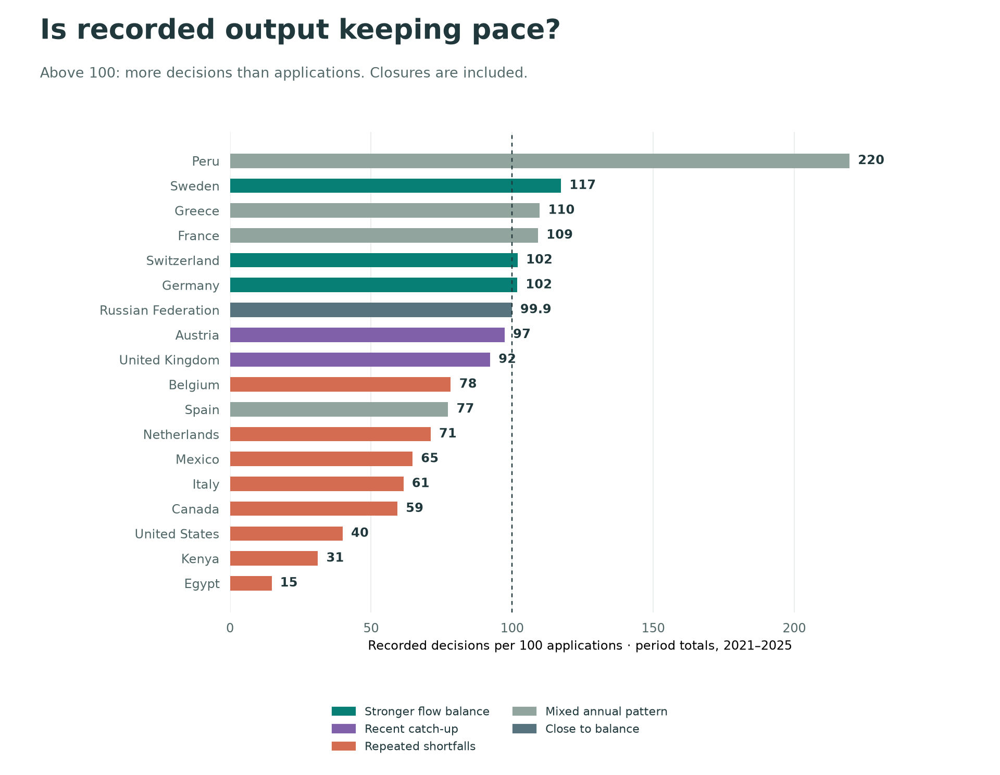

## Who is keeping pace, and who is falling behind? {#processing-assessment}

**A stronger recorded flow balance is not the same as having everything under control.** These data show output relative to inflow, but not whether a country has cleared its pending caseload, shortened waits, or improved decision quality. All recorded decisions, including closures, count as output.

### Stronger flow balances

**Germany** (102), **Sweden** (117), **Switzerland** (102). The figures in brackets are decisions per 100 applications across **2021–2025**, calculated from summed counts. Each of these countries also reached at least 100 across 2023–2025 and in 2025, with shortfalls in no more than two of the five years. That is evidence of a stronger recent balance in reported activity, rather than proof of an efficient or backlog-free system.

**France illustrates the difference between a period balance and the latest year:** it recorded 109 decisions per 100 applications over 2021–2025, but 98 in 2025. Its multi-year output exceeded inflow, while the latest year was slightly below balance.

### Repeated shortfalls

**United States** (40), **Italy** (61), **Canada** (59), **Egypt** (15), **Belgium** (78), **Mexico** (65), **Kenya** (31), **Netherlands** (71). Each had applications exceeding decisions in at least four of the five years, and fewer than 100 decisions per 100 applications in both the five-year and recent three-year totals. Repeated imbalances suggest sustained processing pressure; the size of an actual pending caseload must be established from stock data.

### Which balances have deteriorated?

Comparing **2018–2020 with 2023–2025**, the following complete-coverage countries were below balance in the recent period and fell by at least 10 decisions per 100 applications: **Italy**, 209 → 58; **Egypt**, 100 → 11; **Kenya**, 112 → 30; **Canada**, 80 → 52; **United States**, 56 → 42; **Belgium**, 95 → 82. This is a deterioration in the output-to-inflow ratio, not evidence that staff became less productive: faster application growth can lower the ratio even when decision volumes increase.

The Netherlands and Mexico also have repeated shortfalls, but their recent ratios improved relative to 2018–2020. **Still behind** and **getting further behind** are different findings.

**The Russian Federation was close to balance**, rather than clearly in catch-up: 99.9 decisions per 100 applications in 2021?2025 and 100.4 in 2023?2025. The small difference should not be given more weight than reporting precision allows.

### Catch-up and misleading averages

**United Kingdom** (92), **Austria** (97) show recent catch-up: five-year output was below inflow, but 2023–2025 output exceeded inflow. For the UK this was **92 decisions per 100 applications across 2021–2025**, versus **116 across 2023–2025**. Recent output can be clearing older claims, so a favourable ratio does not establish that pending claims have disappeared.

**Peru needs particular care.** Its high five-year ratio is dominated by **136,383 recorded decisions in 2023**, followed by **1,318 in 2024 and 1,897 in 2025**. Across 2021–2025, approximately **95% of its recorded decisions were closures**. This is not evidence of consistently high substantive decision output; the table labels it a mixed annual pattern.

**Coverage prevents a confident classification for South Africa and Türkiye.** South Africa lacks application volume in 2021; Türkiye lacks decision volume in 2024 and 2025. Their available-year ratios are shown in the table, with the denominator's coverage, but excluded from the complete five-year chart. High output in the years available does not fill those gaps.

{fig-alt="Horizontal bars compare five-year recorded decision output with application volume. A reference line marks 100 decisions per 100 applications; colours identify stronger balances, catch-up, repeated shortfalls and mixed patterns."}

### The full comparison

All three numeric period columns show **decisions per 100 applications**. Values close to the threshold of 100 retain one decimal so rounding does not hide which side of balance they fall on. Period ratios divide summed decisions by summed applications for years with both flows available; they do not average annual ratios. A shortfall year has fewer recorded decisions than applications. Classification is descriptive, based on the explicit thresholds above, and is not a statistical test or an efficiency ranking.

| Receiving country | Assessment | 2021–2025 | 2023–2025 | 2025 | Shortfall years / paired years |
|:--|:--|--:|--:|--:|--:|
| United States | Repeated shortfalls | 40 | 42 | 66 | 5 / 5 |
| Germany | Stronger flow balance | 102 | 102 | 124 | 1 / 5 |
| France | Mixed annual pattern | 109 | 107 | 98 | 2 / 5 |
| United Kingdom | Recent catch-up | 92 | 116 | 116 | 3 / 5 |
| South Africa | Incomplete coverage | 417 (4/5 years) | 249 | 417 | 0 / 4 |
| Italy | Repeated shortfalls | 61 | 58 | 79 | 5 / 5 |
| Canada | Repeated shortfalls | 59 | 52 | 72 | 4 / 5 |
| Egypt | Repeated shortfalls | 15 | 11 | 19 | 5 / 5 |
| Sweden | Stronger flow balance | 117 | 123 | 120 | 1 / 5 |
| Spain | Mixed annual pattern | 77 | 73 | 111 | 3 / 5 |
| Greece | Mixed annual pattern | 110 | 96 | 96 | 2 / 5 |
| Türkiye | Incomplete coverage | 242 (3/5 years) | 426 (1/3 years) | Unavailable | 0 / 3 |
| Austria | Recent catch-up | 97 | 124 | 125 | 2 / 5 |
| Belgium | Repeated shortfalls | 78 | 82 | 82 | 5 / 5 |
| Mexico | Repeated shortfalls | 65 | 78 | 145 | 4 / 5 |
| Russian Federation | Close to balance | 99.9 | 100.4 | 105 | 2 / 5 |
| Switzerland | Stronger flow balance | 102 | 110 | 121 | 2 / 5 |
| Peru | Mixed annual pattern | 220 | 225 | 10 | 3 / 5 |
| Kenya | Repeated shortfalls | 31 | 30 | 103 | 4 / 5 |
| Netherlands | Repeated shortfalls | 71 | 75 | 89 | 5 / 5 |

Source: the same pinned UNHCR mixed-unit, all-procedure extracts as the profiles below. Closures are included; persons and cases are added without conversion. Reporting coverage and procedures differ. The chart omits incomplete five-year coverage. [Download the unrounded assessment (CSV)](data/processing-assessment.csv).
