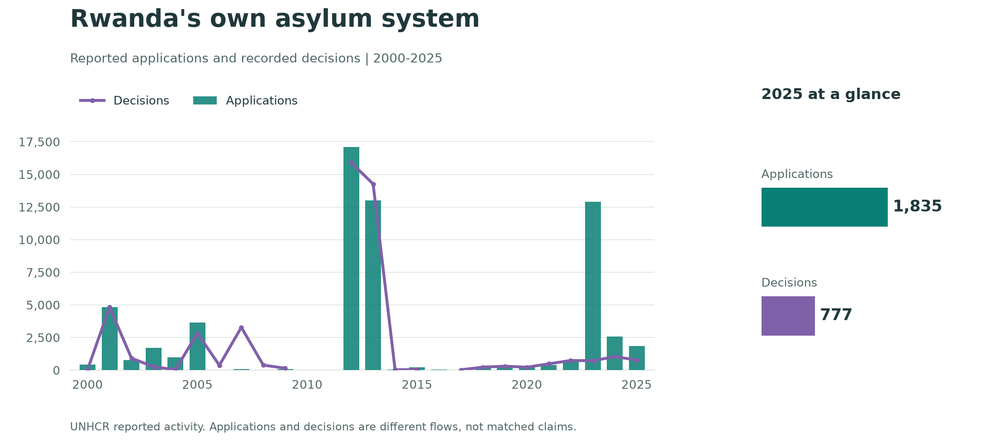
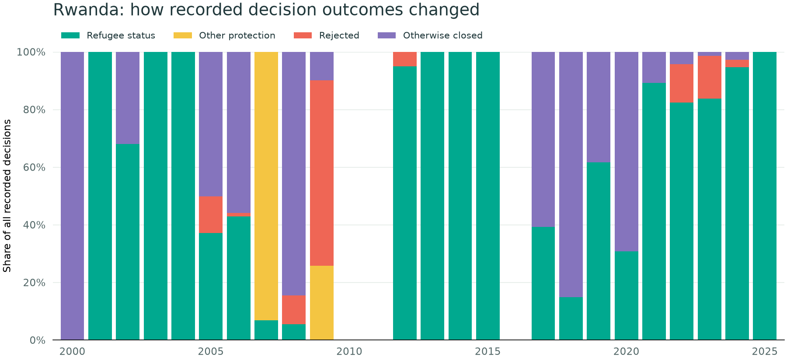

## Rwanda and the former UK asylum partnership {#rwanda}

### What the UK proposed—and what happened

The UK and Rwanda announced their Migration and Economic Development Partnership in **April 2022**. It proposed relocating certain asylum seekers from the UK to Rwanda, where their protection claims would be considered. The **December 2023 treaty** developed the asylum-partnership arrangements. [Home Office background](https://www.gov.uk/government/publications/medp-with-rwanda-and-the-illegal-migration-act-associated-costs/breakdown-of-home-office-costs-associated-with-the-medp-with-rwanda-and-the-illegal-migration-act-2023), [UK–Rwanda asylum-partnership statement](https://www.gov.uk/government/publications/agreement-between-the-united-kingdom-and-the-republic-of-rwanda/statutory-statement-for-the-provision-of-an-asylum-partnership-to-strengthen-shared-international-commitments-on-the-protection-of-refugees-and-migran).

The Home Office **discontinued the policy in July 2024**. This is historical context, not a current UK processing programme. [Home Office confirmation](https://www.gov.uk/government/publications/asylum-claims-under-the-migration-and-economic-development-partnership).

In its **December 2024** account, the Home Office reported that no asylum seekers had been sent to Rwanda under the policy; it separately reported four volunteers. Those volunteers should not be treated as asylum seekers whose claims were processed through the proposed relocation scheme. [Official account](https://www.gov.uk/government/publications/medp-with-rwanda-and-the-illegal-migration-act-associated-costs/breakdown-of-home-office-costs-associated-with-the-medp-with-rwanda-and-the-illegal-migration-act-2023).

### Rwanda's own reported asylum activity

::: {.reading-note}
**These figures describe Rwanda's reported asylum system, not UK-to-Rwanda transfers.** They do not measure the partnership's results or establish how Rwanda would have decided relocated UK claims. The extract has no identifier isolating a UK-relocation cohort, and the aggregate outcomes cannot establish future capacity or individual chances of protection.
:::





{fig-alt="Rwanda's reported applications shown as teal bars, with recorded decisions shown as a purple line, from 2000 to 2025, plus a labelled comparison of 1,835 applications and 777 decisions in 2025." fig-cap="UNHCR pinned application and decision extracts; all reported procedures, original persons and cases combined without conversion. This is a different scope from the first-instance persons-only UK comparison above. Application and decision flows are not matched cohorts; their difference is not an observed backlog."}



{fig-alt="Annual decision-outcome shares in Rwanda, including administrative closures, using a common zero-to-100-percent scale." fig-cap="Each outcome is divided by all recorded decisions in the same year, including closures. Shares appear only for complete positive totals that reconcile. Gaps mean unavailable values; changes in reporting coverage, procedure, and case mix affect interpretation."}

[Download Rwanda's annual counts, flow ratios and unrounded outcome shares (CSV)](data/uk/rwanda-annual.csv). Source: the same pinned UNHCR 2000–2025 files documented on [Methods & sources](methods.qmd). These country-level figures concern applications and decisions, not Rwanda's wider refugee population.

[Compare Rwanda's asylum activity per 100,000 residents](population.html?country=RWA).
