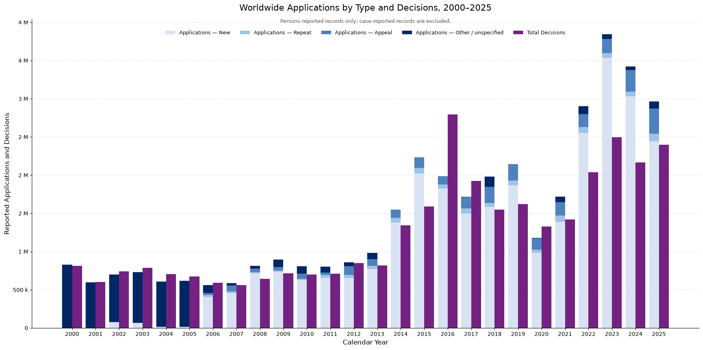
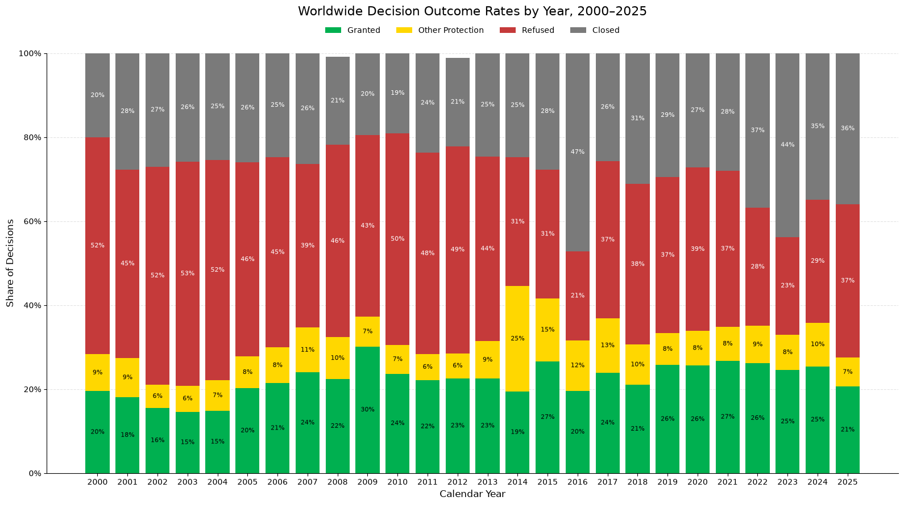
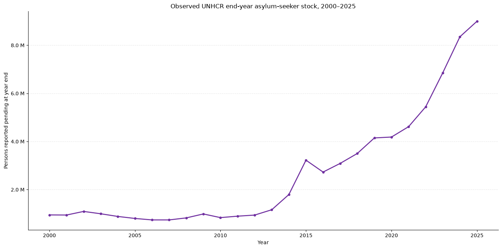
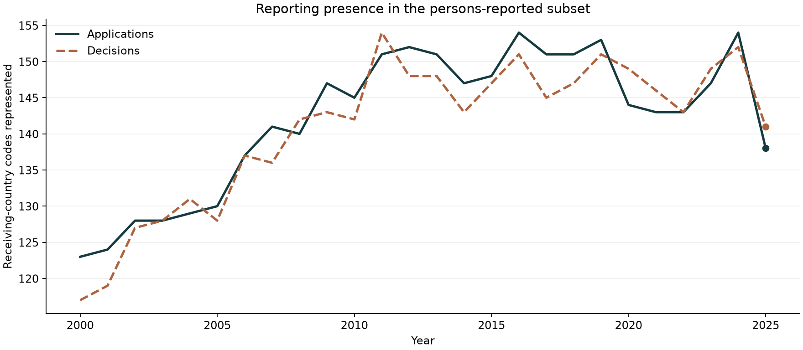

::: {.eyebrow}
Worldwide trends · Sample chapter · 2000–2025
:::

::: {.lead}
An application starts a process. A decision records an outcome. A pending claim is still awaiting resolution at a particular date. Each tells us something different about asylum systems—and the distinction matters when we read the numbers.
:::

This chapter asks three questions: **how has reported application volume changed, what outcomes are recorded, and how many claims remain pending?** It uses selected charts from the full analysis, with the source definitions and calculations available on the [methods page](methods.qmd).



::: {.reading-note}
**A note about units.** The application and decision charts use records reported as **persons**. Records reported as **cases** are excluded, rather than converted using an assumed family size. An application event is still not necessarily a unique person: the source includes new claims, repeats, and appeals.
:::

**Choose a receiving country:** [Open the interactive country explorer](explore.qmd) for applications, decisions, source downloads, and its latest refresh date.

## 1. Applications and decisions follow different timelines {#applications}



The bars separate application types, while the adjacent decisions show the volume recorded in the same year. They do not link the people applying with the people receiving decisions. A claim filed in one year may be decided in another.

{fig-alt="Worldwide persons-reported applications by type alongside annual recorded decisions, from 2000 to 2025." #fig-flows fig-cap="Applications and decisions are annual flows, not matched cohorts. Application bars include new, repeat, appeal, and other or unspecified types. Persons-reported records only; source coverage varies over time."}

::: {.takeaway}
**What to take from this:** compare the flows, but avoid describing their ratio as a success rate, a waiting time, or a measure of processing efficiency.
:::

## 2. A decision does not always mean recognition {#outcomes}

The source distinguishes recognised refugee status, complementary protection, rejection, and administrative closure. Looking only at recognised decisions would leave out substantial parts of what asylum authorities record.

The next chart shows how decision composition changes by year. Each column describes that year's decisions, rather than the eventual outcomes of applications lodged that year.

{fig-alt="Annual proportions of persons-reported decisions by recognised status, complementary protection, rejection, and administrative closure." #fig-outcomes fig-cap="Outcome shares divide each recorded outcome by all recorded decisions in the year, including administrative closures. Persons-reported records only. Changing reporting coverage can also change the composition."}



::: {.callout-note title="Two denominators, two questions"}
The **recognised share of all decisions** includes administrative closures in the denominator. UNHCR's **refugee recognition rate** uses substantive decisions and excludes those closures. A percentage calculated one way should not be labelled as the other. [See the definitions and formulae](methods.qmd#decision-rates).
:::

## 3. Pending claims need their own measure {#pending}

Subtracting annual decisions from applications can be tempting. But the result is a difference between flows—not a count of unresolved claims.

Here we use UNHCR's **observed end-year asylum-seeker stock** instead. This is a separate population series, reported at a date. It is not reconstructed by adding up the gaps between the bars in the first figure.

{fig-alt="Observed UNHCR worldwide end-year asylum-seeker stocks, reported in persons from 2000 to 2025." #fig-pending fig-cap="Observed UNHCR end-year asylum-seeker stock, summed from the population API. The series reflects reports available for each year; coverage and revisions may affect totals. It has a different statistical scope from the persons-reported flow subset above."}

::: {.takeaway}
**What to take from this:** use observed stocks when asking how many claims are pending. Annual applications minus decisions cannot establish a reconciled backlog, and these data do not provide individual waiting times.
:::

## Before interpreting the latest year, check who reported {#coverage}

A worldwide sum can change because of the records available, as well as because of underlying events. One practical check is to count receiving-country codes represented in each year's data.



{fig-alt="Number of receiving-country codes with persons-reported application and decision records in each year." #fig-coverage fig-cap="Receiving-country codes represented by at least one persons-reported row. Counts indicate reporting presence, not completeness, population coverage, or the quality of each return. Applications and decisions can have different reporters."}

This does not tell us which explanation accounts for a change in volume. It does tell us why a lower recorded total should not automatically become a claim that worldwide demand has fallen by the same proportion.

## Reading the figures together {#conclusion}

The figures support a more careful account when we keep their questions separate:

- **Applications:** how many application events were recorded, and of which types?
- **Decisions:** what outcomes did reporting authorities record?
- **Pending claims:** what unresolved stock was observed at the reporting date?

They do not, by themselves, explain national policy differences, measure an applicant's chance of recognition, or establish how long people wait.

::: {.report-end}
**Go further:** [Read the methods and sources](methods.qmd), inspect the [full analysis notebook](https://github.com/aloysius109/python-charts/blob/main/UNHCRData.ipynb), or explore [UNHCR's methodology](https://www.unhcr.org/refugee-statistics/methodology).

This is an independent analysis, not an official UNHCR publication. Figures describe the saved extracts and observed stock data used for this edition.
:::
