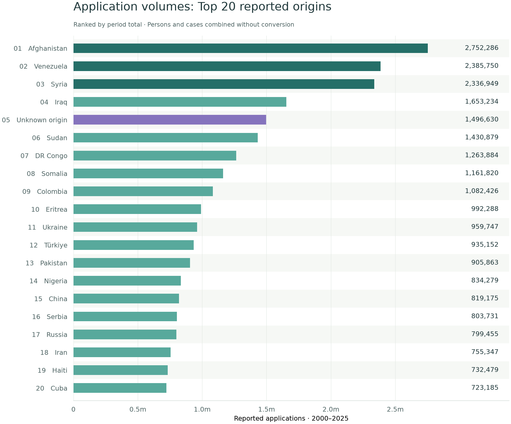

These multicoloured charts follow one **country of origin** at a time. The colours identify **receiving countries**; each receiving country keeps its colour across the three panels of that profile. Click any chart to open the full-size version.

**Notebook edition: 2000-2025.** These exploratory profiles retain the original persons- and case-reported values; see the reading guide for interpretation.

## How large are these application flows?

::: {.snapshot}

24.8mreported applications from the Top 20 origins, 2000–2025

61%of all reported applications in the same saved extract

2,752,286from Afghanistan the largest recorded origin

:::

{fig-alt="Horizontal bars showing all 20 origins in descending application volume, with exact totals labelled." fig-cap="Period totals sum original persons- and case-reported applications without conversion. They count reported application activity, not unique people. Unknown origin is included where recorded. These colours distinguish known and unknown origin, not receiving destinations."}

[See these origins on a map](maps.qmd#origin-map) ? [Download exact volumes and shares (CSV)](assets/origins/application-volumes.csv)

::: {.callout-note collapse="true" title="How to read these charts"}
**How to read each profile:** the top panel shows destinations' shares of recorded applications. The middle panel shows their shares of recognised refugee-status decisions. The lower panel compares those two distributions in **percentage points**. It is not a grant rate or an individual's chance of recognition: decisions may concern earlier applications.

The figures use the data and calculations from the **2000–2025 notebook edition**. They combine original persons- and case-reported values and are exploratory comparisons, not harmonised counts of people. The 20 origins are selected by combined reported application volume. The six featured destinations per origin are selected using their combined shares of applications and recognised decisions; the remainder form **Other (OTH)**.
:::



## Explore another country of origin

Choose from **215 recorded origins** to see where applications were made and where refugee status was recognised. The featured 20 profiles are also available in the dropdown, with the same colours and three-panel layout.

<label for="origin-profile-select">Country of origin</label>
<select id="origin-profile-select" aria-controls="origin-selected-profile">
<option value="">Choose a country of origin...</option>
<optgroup label="Additional origins">
<option value="ALB" data-profile-src="assets/origins/additional/alb.png?v=contrast2" data-profile-name="Albania">Albania (ALB)</option>
<option value="DZA" data-profile-src="assets/origins/additional/dza.png?v=contrast2" data-profile-name="Algeria">Algeria (DZA)</option>
<option value="AND" data-profile-src="assets/origins/additional/and.png?v=contrast2" data-profile-name="Andorra">Andorra (AND)</option>
<option value="AGO" data-profile-src="assets/origins/additional/ago.png?v=contrast2" data-profile-name="Angola">Angola (AGO)</option>
<option value="AIA" data-profile-src="assets/origins/additional/aia.png?v=contrast2" data-profile-name="Anguilla">Anguilla (AIA)</option>
<option value="ATG" data-profile-src="assets/origins/additional/atg.png?v=contrast2" data-profile-name="Antigua and Barbuda">Antigua and Barbuda (ATG)</option>
<option value="ARG" data-profile-src="assets/origins/additional/arg.png?v=contrast2" data-profile-name="Argentina">Argentina (ARG)</option>
<option value="ARM" data-profile-src="assets/origins/additional/arm.png?v=contrast2" data-profile-name="Armenia">Armenia (ARM)</option>
<option value="AUS" data-profile-src="assets/origins/additional/aus.png?v=contrast2" data-profile-name="Australia">Australia (AUS)</option>
<option value="AUT" data-profile-src="assets/origins/additional/aut.png?v=contrast2" data-profile-name="Austria">Austria (AUT)</option>
<option value="AZE" data-profile-src="assets/origins/additional/aze.png?v=contrast2" data-profile-name="Azerbaijan">Azerbaijan (AZE)</option>
<option value="BHS" data-profile-src="assets/origins/additional/bhs.png?v=contrast2" data-profile-name="Bahamas">Bahamas (BHS)</option>
<option value="BHR" data-profile-src="assets/origins/additional/bhr.png?v=contrast2" data-profile-name="Bahrain">Bahrain (BHR)</option>
<option value="BGD" data-profile-src="assets/origins/additional/bgd.png?v=contrast2" data-profile-name="Bangladesh">Bangladesh (BGD)</option>
<option value="BRB" data-profile-src="assets/origins/additional/brb.png?v=contrast2" data-profile-name="Barbados">Barbados (BRB)</option>
<option value="BLR" data-profile-src="assets/origins/additional/blr.png?v=contrast2" data-profile-name="Belarus">Belarus (BLR)</option>
<option value="BEL" data-profile-src="assets/origins/additional/bel.png?v=contrast2" data-profile-name="Belgium">Belgium (BEL)</option>
<option value="BLZ" data-profile-src="assets/origins/additional/blz.png?v=contrast2" data-profile-name="Belize">Belize (BLZ)</option>
<option value="BEN" data-profile-src="assets/origins/additional/ben.png?v=contrast2" data-profile-name="Benin">Benin (BEN)</option>
<option value="BMU" data-profile-src="assets/origins/additional/bmu.png?v=contrast2" data-profile-name="Bermuda">Bermuda (BMU)</option>
<option value="BTN" data-profile-src="assets/origins/additional/btn.png?v=contrast2" data-profile-name="Bhutan">Bhutan (BTN)</option>
<option value="BOL" data-profile-src="assets/origins/additional/bol.png?v=contrast2" data-profile-name="Bolivia, Plurinational State of">Bolivia, Plurinational State of (BOL)</option>
<option value="BES" data-profile-src="assets/origins/additional/bes.png?v=contrast2" data-profile-name="Bonaire, Sint Eustatius and Saba">Bonaire, Sint Eustatius and Saba (BES)</option>
<option value="BIH" data-profile-src="assets/origins/additional/bih.png?v=contrast2" data-profile-name="Bosnia and Herzegovina">Bosnia and Herzegovina (BIH)</option>
<option value="BWA" data-profile-src="assets/origins/additional/bwa.png?v=contrast2" data-profile-name="Botswana">Botswana (BWA)</option>
<option value="BRA" data-profile-src="assets/origins/additional/bra.png?v=contrast2" data-profile-name="Brazil">Brazil (BRA)</option>
<option value="BRN" data-profile-src="assets/origins/additional/brn.png?v=contrast2" data-profile-name="Brunei Darussalam">Brunei Darussalam (BRN)</option>
<option value="BGR" data-profile-src="assets/origins/additional/bgr.png?v=contrast2" data-profile-name="Bulgaria">Bulgaria (BGR)</option>
<option value="BFA" data-profile-src="assets/origins/additional/bfa.png?v=contrast2" data-profile-name="Burkina Faso">Burkina Faso (BFA)</option>
<option value="BDI" data-profile-src="assets/origins/additional/bdi.png?v=contrast2" data-profile-name="Burundi">Burundi (BDI)</option>
<option value="CPV" data-profile-src="assets/origins/additional/cpv.png?v=contrast2" data-profile-name="Cabo Verde">Cabo Verde (CPV)</option>
<option value="KHM" data-profile-src="assets/origins/additional/khm.png?v=contrast2" data-profile-name="Cambodia">Cambodia (KHM)</option>
<option value="CMR" data-profile-src="assets/origins/additional/cmr.png?v=contrast2" data-profile-name="Cameroon">Cameroon (CMR)</option>
<option value="CAN" data-profile-src="assets/origins/additional/can.png?v=contrast2" data-profile-name="Canada">Canada (CAN)</option>
<option value="CYM" data-profile-src="assets/origins/additional/cym.png?v=contrast2" data-profile-name="Cayman Islands">Cayman Islands (CYM)</option>
<option value="CAF" data-profile-src="assets/origins/additional/caf.png?v=contrast2" data-profile-name="Central African Republic">Central African Republic (CAF)</option>
<option value="TCD" data-profile-src="assets/origins/additional/tcd.png?v=contrast2" data-profile-name="Chad">Chad (TCD)</option>
<option value="CHL" data-profile-src="assets/origins/additional/chl.png?v=contrast2" data-profile-name="Chile">Chile (CHL)</option>
<option value="COM" data-profile-src="assets/origins/additional/com.png?v=contrast2" data-profile-name="Comoros">Comoros (COM)</option>
<option value="COG" data-profile-src="assets/origins/additional/cog.png?v=contrast2" data-profile-name="Congo">Congo (COG)</option>
<option value="COK" data-profile-src="assets/origins/additional/cok.png?v=contrast2" data-profile-name="Cook Islands">Cook Islands (COK)</option>
<option value="CRI" data-profile-src="assets/origins/additional/cri.png?v=contrast2" data-profile-name="Costa Rica">Costa Rica (CRI)</option>
<option value="HRV" data-profile-src="assets/origins/additional/hrv.png?v=contrast2" data-profile-name="Croatia">Croatia (HRV)</option>
<option value="CUW" data-profile-src="assets/origins/additional/cuw.png?v=contrast2" data-profile-name="Curaçao">Curaçao (CUW)</option>
<option value="CYP" data-profile-src="assets/origins/additional/cyp.png?v=contrast2" data-profile-name="Cyprus">Cyprus (CYP)</option>
<option value="CZE" data-profile-src="assets/origins/additional/cze.png?v=contrast2" data-profile-name="Czechia">Czechia (CZE)</option>
<option value="CIV" data-profile-src="assets/origins/additional/civ.png?v=contrast2" data-profile-name="Côte d&#x27;Ivoire">Côte d&#x27;Ivoire (CIV)</option>
<option value="DNK" data-profile-src="assets/origins/additional/dnk.png?v=contrast2" data-profile-name="Denmark">Denmark (DNK)</option>
<option value="DJI" data-profile-src="assets/origins/additional/dji.png?v=contrast2" data-profile-name="Djibouti">Djibouti (DJI)</option>
<option value="DMA" data-profile-src="assets/origins/additional/dma.png?v=contrast2" data-profile-name="Dominica">Dominica (DMA)</option>
<option value="DOM" data-profile-src="assets/origins/additional/dom.png?v=contrast2" data-profile-name="Dominican Republic">Dominican Republic (DOM)</option>
<option value="ECU" data-profile-src="assets/origins/additional/ecu.png?v=contrast2" data-profile-name="Ecuador">Ecuador (ECU)</option>
<option value="EGY" data-profile-src="assets/origins/additional/egy.png?v=contrast2" data-profile-name="Egypt">Egypt (EGY)</option>
<option value="SLV" data-profile-src="assets/origins/additional/slv.png?v=contrast2" data-profile-name="El Salvador">El Salvador (SLV)</option>
<option value="GNQ" data-profile-src="assets/origins/additional/gnq.png?v=contrast2" data-profile-name="Equatorial Guinea">Equatorial Guinea (GNQ)</option>
<option value="EST" data-profile-src="assets/origins/additional/est.png?v=contrast2" data-profile-name="Estonia">Estonia (EST)</option>
<option value="SWZ" data-profile-src="assets/origins/additional/swz.png?v=contrast2" data-profile-name="Eswatini">Eswatini (SWZ)</option>
<option value="ETH" data-profile-src="assets/origins/additional/eth.png?v=contrast2" data-profile-name="Ethiopia">Ethiopia (ETH)</option>
<option value="FJI" data-profile-src="assets/origins/additional/fji.png?v=contrast2" data-profile-name="Fiji">Fiji (FJI)</option>
<option value="FIN" data-profile-src="assets/origins/additional/fin.png?v=contrast2" data-profile-name="Finland">Finland (FIN)</option>
<option value="FRA" data-profile-src="assets/origins/additional/fra.png?v=contrast2" data-profile-name="France">France (FRA)</option>
<option value="GUF" data-profile-src="assets/origins/additional/guf.png?v=contrast2" data-profile-name="French Guiana">French Guiana (GUF)</option>
<option value="GAB" data-profile-src="assets/origins/additional/gab.png?v=contrast2" data-profile-name="Gabon">Gabon (GAB)</option>
<option value="GMB" data-profile-src="assets/origins/additional/gmb.png?v=contrast2" data-profile-name="Gambia">Gambia (GMB)</option>
<option value="GEO" data-profile-src="assets/origins/additional/geo.png?v=contrast2" data-profile-name="Georgia">Georgia (GEO)</option>
<option value="DEU" data-profile-src="assets/origins/additional/deu.png?v=contrast2" data-profile-name="Germany">Germany (DEU)</option>
<option value="GHA" data-profile-src="assets/origins/additional/gha.png?v=contrast2" data-profile-name="Ghana">Ghana (GHA)</option>
<option value="GIB" data-profile-src="assets/origins/additional/gib.png?v=contrast2" data-profile-name="Gibraltar">Gibraltar (GIB)</option>
<option value="GRC" data-profile-src="assets/origins/additional/grc.png?v=contrast2" data-profile-name="Greece">Greece (GRC)</option>
<option value="GRD" data-profile-src="assets/origins/additional/grd.png?v=contrast2" data-profile-name="Grenada">Grenada (GRD)</option>
<option value="GLP" data-profile-src="assets/origins/additional/glp.png?v=contrast2" data-profile-name="Guadeloupe">Guadeloupe (GLP)</option>
<option value="GTM" data-profile-src="assets/origins/additional/gtm.png?v=contrast2" data-profile-name="Guatemala">Guatemala (GTM)</option>
<option value="GIN" data-profile-src="assets/origins/additional/gin.png?v=contrast2" data-profile-name="Guinea">Guinea (GIN)</option>
<option value="GNB" data-profile-src="assets/origins/additional/gnb.png?v=contrast2" data-profile-name="Guinea-Bissau">Guinea-Bissau (GNB)</option>
<option value="GUY" data-profile-src="assets/origins/additional/guy.png?v=contrast2" data-profile-name="Guyana">Guyana (GUY)</option>
<option value="VAT" data-profile-src="assets/origins/additional/vat.png?v=contrast2" data-profile-name="Holy See (Vatican City State)">Holy See (Vatican City State) (VAT)</option>
<option value="HND" data-profile-src="assets/origins/additional/hnd.png?v=contrast2" data-profile-name="Honduras">Honduras (HND)</option>
<option value="HKG" data-profile-src="assets/origins/additional/hkg.png?v=contrast2" data-profile-name="Hong Kong">Hong Kong (HKG)</option>
<option value="HUN" data-profile-src="assets/origins/additional/hun.png?v=contrast2" data-profile-name="Hungary">Hungary (HUN)</option>
<option value="ISL" data-profile-src="assets/origins/additional/isl.png?v=contrast2" data-profile-name="Iceland">Iceland (ISL)</option>
<option value="IND" data-profile-src="assets/origins/additional/ind.png?v=contrast2" data-profile-name="India">India (IND)</option>
<option value="IDN" data-profile-src="assets/origins/additional/idn.png?v=contrast2" data-profile-name="Indonesia">Indonesia (IDN)</option>
<option value="IRL" data-profile-src="assets/origins/additional/irl.png?v=contrast2" data-profile-name="Ireland">Ireland (IRL)</option>
<option value="ISR" data-profile-src="assets/origins/additional/isr.png?v=contrast2" data-profile-name="Israel">Israel (ISR)</option>
<option value="ITA" data-profile-src="assets/origins/additional/ita.png?v=contrast2" data-profile-name="Italy">Italy (ITA)</option>
<option value="JAM" data-profile-src="assets/origins/additional/jam.png?v=contrast2" data-profile-name="Jamaica">Jamaica (JAM)</option>
<option value="JPN" data-profile-src="assets/origins/additional/jpn.png?v=contrast2" data-profile-name="Japan">Japan (JPN)</option>
<option value="JOR" data-profile-src="assets/origins/additional/jor.png?v=contrast2" data-profile-name="Jordan">Jordan (JOR)</option>
<option value="KAZ" data-profile-src="assets/origins/additional/kaz.png?v=contrast2" data-profile-name="Kazakhstan">Kazakhstan (KAZ)</option>
<option value="KEN" data-profile-src="assets/origins/additional/ken.png?v=contrast2" data-profile-name="Kenya">Kenya (KEN)</option>
<option value="KIR" data-profile-src="assets/origins/additional/kir.png?v=contrast2" data-profile-name="Kiribati">Kiribati (KIR)</option>
<option value="PRK" data-profile-src="assets/origins/additional/prk.png?v=contrast2" data-profile-name="Korea, Democratic People&#x27;s Republic of">Korea, Democratic People&#x27;s Republic of (PRK)</option>
<option value="KOR" data-profile-src="assets/origins/additional/kor.png?v=contrast2" data-profile-name="Korea, Republic of">Korea, Republic of (KOR)</option>
<option value="KWT" data-profile-src="assets/origins/additional/kwt.png?v=contrast2" data-profile-name="Kuwait">Kuwait (KWT)</option>
<option value="KGZ" data-profile-src="assets/origins/additional/kgz.png?v=contrast2" data-profile-name="Kyrgyzstan">Kyrgyzstan (KGZ)</option>
<option value="LAO" data-profile-src="assets/origins/additional/lao.png?v=contrast2" data-profile-name="Lao People&#x27;s Democratic Republic">Lao People&#x27;s Democratic Republic (LAO)</option>
<option value="LVA" data-profile-src="assets/origins/additional/lva.png?v=contrast2" data-profile-name="Latvia">Latvia (LVA)</option>
<option value="LBN" data-profile-src="assets/origins/additional/lbn.png?v=contrast2" data-profile-name="Lebanon">Lebanon (LBN)</option>
<option value="LSO" data-profile-src="assets/origins/additional/lso.png?v=contrast2" data-profile-name="Lesotho">Lesotho (LSO)</option>
<option value="LBR" data-profile-src="assets/origins/additional/lbr.png?v=contrast2" data-profile-name="Liberia">Liberia (LBR)</option>
<option value="LBY" data-profile-src="assets/origins/additional/lby.png?v=contrast2" data-profile-name="Libya">Libya (LBY)</option>
<option value="LIE" data-profile-src="assets/origins/additional/lie.png?v=contrast2" data-profile-name="Liechtenstein">Liechtenstein (LIE)</option>
<option value="LTU" data-profile-src="assets/origins/additional/ltu.png?v=contrast2" data-profile-name="Lithuania">Lithuania (LTU)</option>
<option value="LUX" data-profile-src="assets/origins/additional/lux.png?v=contrast2" data-profile-name="Luxembourg">Luxembourg (LUX)</option>
<option value="MAC" data-profile-src="assets/origins/additional/mac.png?v=contrast2" data-profile-name="Macao">Macao (MAC)</option>
<option value="MDG" data-profile-src="assets/origins/additional/mdg.png?v=contrast2" data-profile-name="Madagascar">Madagascar (MDG)</option>
<option value="MWI" data-profile-src="assets/origins/additional/mwi.png?v=contrast2" data-profile-name="Malawi">Malawi (MWI)</option>
<option value="MYS" data-profile-src="assets/origins/additional/mys.png?v=contrast2" data-profile-name="Malaysia">Malaysia (MYS)</option>
<option value="MDV" data-profile-src="assets/origins/additional/mdv.png?v=contrast2" data-profile-name="Maldives">Maldives (MDV)</option>
<option value="MLI" data-profile-src="assets/origins/additional/mli.png?v=contrast2" data-profile-name="Mali">Mali (MLI)</option>
<option value="MLT" data-profile-src="assets/origins/additional/mlt.png?v=contrast2" data-profile-name="Malta">Malta (MLT)</option>
<option value="MHL" data-profile-src="assets/origins/additional/mhl.png?v=contrast2" data-profile-name="Marshall Islands">Marshall Islands (MHL)</option>
<option value="MTQ" data-profile-src="assets/origins/additional/mtq.png?v=contrast2" data-profile-name="Martinique">Martinique (MTQ)</option>
<option value="MRT" data-profile-src="assets/origins/additional/mrt.png?v=contrast2" data-profile-name="Mauritania">Mauritania (MRT)</option>
<option value="MUS" data-profile-src="assets/origins/additional/mus.png?v=contrast2" data-profile-name="Mauritius">Mauritius (MUS)</option>
<option value="MEX" data-profile-src="assets/origins/additional/mex.png?v=contrast2" data-profile-name="Mexico">Mexico (MEX)</option>
<option value="FSM" data-profile-src="assets/origins/additional/fsm.png?v=contrast2" data-profile-name="Micronesia, Federated States of">Micronesia, Federated States of (FSM)</option>
<option value="MDA" data-profile-src="assets/origins/additional/mda.png?v=contrast2" data-profile-name="Moldova, Republic of">Moldova, Republic of (MDA)</option>
<option value="MCO" data-profile-src="assets/origins/additional/mco.png?v=contrast2" data-profile-name="Monaco">Monaco (MCO)</option>
<option value="MNG" data-profile-src="assets/origins/additional/mng.png?v=contrast2" data-profile-name="Mongolia">Mongolia (MNG)</option>
<option value="MNE" data-profile-src="assets/origins/additional/mne.png?v=contrast2" data-profile-name="Montenegro">Montenegro (MNE)</option>
<option value="MAR" data-profile-src="assets/origins/additional/mar.png?v=contrast2" data-profile-name="Morocco">Morocco (MAR)</option>
<option value="MOZ" data-profile-src="assets/origins/additional/moz.png?v=contrast2" data-profile-name="Mozambique">Mozambique (MOZ)</option>
<option value="MMR" data-profile-src="assets/origins/additional/mmr.png?v=contrast2" data-profile-name="Myanmar">Myanmar (MMR)</option>
<option value="NAM" data-profile-src="assets/origins/additional/nam.png?v=contrast2" data-profile-name="Namibia">Namibia (NAM)</option>
<option value="NRU" data-profile-src="assets/origins/additional/nru.png?v=contrast2" data-profile-name="Nauru">Nauru (NRU)</option>
<option value="NPL" data-profile-src="assets/origins/additional/npl.png?v=contrast2" data-profile-name="Nepal">Nepal (NPL)</option>
<option value="NLD" data-profile-src="assets/origins/additional/nld.png?v=contrast2" data-profile-name="Netherlands">Netherlands (NLD)</option>
<option value="NZL" data-profile-src="assets/origins/additional/nzl.png?v=contrast2" data-profile-name="New Zealand">New Zealand (NZL)</option>
<option value="NIC" data-profile-src="assets/origins/additional/nic.png?v=contrast2" data-profile-name="Nicaragua">Nicaragua (NIC)</option>
<option value="NER" data-profile-src="assets/origins/additional/ner.png?v=contrast2" data-profile-name="Niger">Niger (NER)</option>
<option value="NIU" data-profile-src="assets/origins/additional/niu.png?v=contrast2" data-profile-name="Niue">Niue (NIU)</option>
<option value="MKD" data-profile-src="assets/origins/additional/mkd.png?v=contrast2" data-profile-name="North Macedonia">North Macedonia (MKD)</option>
<option value="NOR" data-profile-src="assets/origins/additional/nor.png?v=contrast2" data-profile-name="Norway">Norway (NOR)</option>
<option value="OMN" data-profile-src="assets/origins/additional/omn.png?v=contrast2" data-profile-name="Oman">Oman (OMN)</option>
<option value="PLW" data-profile-src="assets/origins/additional/plw.png?v=contrast2" data-profile-name="Palau">Palau (PLW)</option>
<option value="PSE" data-profile-src="assets/origins/additional/pse.png?v=contrast2" data-profile-name="Palestine, State of">Palestine, State of (PSE)</option>
<option value="PAN" data-profile-src="assets/origins/additional/pan.png?v=contrast2" data-profile-name="Panama">Panama (PAN)</option>
<option value="PNG" data-profile-src="assets/origins/additional/png.png?v=contrast2" data-profile-name="Papua New Guinea">Papua New Guinea (PNG)</option>
<option value="PRY" data-profile-src="assets/origins/additional/pry.png?v=contrast2" data-profile-name="Paraguay">Paraguay (PRY)</option>
<option value="PER" data-profile-src="assets/origins/additional/per.png?v=contrast2" data-profile-name="Peru">Peru (PER)</option>
<option value="PHL" data-profile-src="assets/origins/additional/phl.png?v=contrast2" data-profile-name="Philippines">Philippines (PHL)</option>
<option value="POL" data-profile-src="assets/origins/additional/pol.png?v=contrast2" data-profile-name="Poland">Poland (POL)</option>
<option value="PRT" data-profile-src="assets/origins/additional/prt.png?v=contrast2" data-profile-name="Portugal">Portugal (PRT)</option>
<option value="PRI" data-profile-src="assets/origins/additional/pri.png?v=contrast2" data-profile-name="Puerto Rico">Puerto Rico (PRI)</option>
<option value="QAT" data-profile-src="assets/origins/additional/qat.png?v=contrast2" data-profile-name="Qatar">Qatar (QAT)</option>
<option value="ROU" data-profile-src="assets/origins/additional/rou.png?v=contrast2" data-profile-name="Romania">Romania (ROU)</option>
<option value="RWA" data-profile-src="assets/origins/additional/rwa.png?v=contrast2" data-profile-name="Rwanda">Rwanda (RWA)</option>
<option value="KNA" data-profile-src="assets/origins/additional/kna.png?v=contrast2" data-profile-name="Saint Kitts and Nevis">Saint Kitts and Nevis (KNA)</option>
<option value="LCA" data-profile-src="assets/origins/additional/lca.png?v=contrast2" data-profile-name="Saint Lucia">Saint Lucia (LCA)</option>
<option value="MAF" data-profile-src="assets/origins/additional/maf.png?v=contrast2" data-profile-name="Saint Martin (French part)">Saint Martin (French part) (MAF)</option>
<option value="VCT" data-profile-src="assets/origins/additional/vct.png?v=contrast2" data-profile-name="Saint Vincent and the Grenadines">Saint Vincent and the Grenadines (VCT)</option>
<option value="WSM" data-profile-src="assets/origins/additional/wsm.png?v=contrast2" data-profile-name="Samoa">Samoa (WSM)</option>
<option value="SMR" data-profile-src="assets/origins/additional/smr.png?v=contrast2" data-profile-name="San Marino">San Marino (SMR)</option>
<option value="STP" data-profile-src="assets/origins/additional/stp.png?v=contrast2" data-profile-name="Sao Tome and Principe">Sao Tome and Principe (STP)</option>
<option value="SAU" data-profile-src="assets/origins/additional/sau.png?v=contrast2" data-profile-name="Saudi Arabia">Saudi Arabia (SAU)</option>
<option value="SEN" data-profile-src="assets/origins/additional/sen.png?v=contrast2" data-profile-name="Senegal">Senegal (SEN)</option>
<option value="SYC" data-profile-src="assets/origins/additional/syc.png?v=contrast2" data-profile-name="Seychelles">Seychelles (SYC)</option>
<option value="SLE" data-profile-src="assets/origins/additional/sle.png?v=contrast2" data-profile-name="Sierra Leone">Sierra Leone (SLE)</option>
<option value="SGP" data-profile-src="assets/origins/additional/sgp.png?v=contrast2" data-profile-name="Singapore">Singapore (SGP)</option>
<option value="SVK" data-profile-src="assets/origins/additional/svk.png?v=contrast2" data-profile-name="Slovakia">Slovakia (SVK)</option>
<option value="SVN" data-profile-src="assets/origins/additional/svn.png?v=contrast2" data-profile-name="Slovenia">Slovenia (SVN)</option>
<option value="SLB" data-profile-src="assets/origins/additional/slb.png?v=contrast2" data-profile-name="Solomon Islands">Solomon Islands (SLB)</option>
<option value="ZAF" data-profile-src="assets/origins/additional/zaf.png?v=contrast2" data-profile-name="South Africa">South Africa (ZAF)</option>
<option value="SSD" data-profile-src="assets/origins/additional/ssd.png?v=contrast2" data-profile-name="South Sudan">South Sudan (SSD)</option>
<option value="ESP" data-profile-src="assets/origins/additional/esp.png?v=contrast2" data-profile-name="Spain">Spain (ESP)</option>
<option value="LKA" data-profile-src="assets/origins/additional/lka.png?v=contrast2" data-profile-name="Sri Lanka">Sri Lanka (LKA)</option>
<option value="XXA" data-profile-src="assets/origins/additional/xxa.png?v=contrast2" data-profile-name="Stateless">Stateless (XXA)</option>
<option value="SUR" data-profile-src="assets/origins/additional/sur.png?v=contrast2" data-profile-name="Suriname">Suriname (SUR)</option>
<option value="SWE" data-profile-src="assets/origins/additional/swe.png?v=contrast2" data-profile-name="Sweden">Sweden (SWE)</option>
<option value="CHE" data-profile-src="assets/origins/additional/che.png?v=contrast2" data-profile-name="Switzerland">Switzerland (CHE)</option>
<option value="TJK" data-profile-src="assets/origins/additional/tjk.png?v=contrast2" data-profile-name="Tajikistan">Tajikistan (TJK)</option>
<option value="TZA" data-profile-src="assets/origins/additional/tza.png?v=contrast2" data-profile-name="Tanzania, United Republic of">Tanzania, United Republic of (TZA)</option>
<option value="THA" data-profile-src="assets/origins/additional/tha.png?v=contrast2" data-profile-name="Thailand">Thailand (THA)</option>
<option value="TIB" data-profile-src="assets/origins/additional/tib.png?v=contrast2" data-profile-name="Tibetan">Tibetan (TIB)</option>
<option value="TLS" data-profile-src="assets/origins/additional/tls.png?v=contrast2" data-profile-name="Timor-Leste">Timor-Leste (TLS)</option>
<option value="TGO" data-profile-src="assets/origins/additional/tgo.png?v=contrast2" data-profile-name="Togo">Togo (TGO)</option>
<option value="TON" data-profile-src="assets/origins/additional/ton.png?v=contrast2" data-profile-name="Tonga">Tonga (TON)</option>
<option value="TTO" data-profile-src="assets/origins/additional/tto.png?v=contrast2" data-profile-name="Trinidad and Tobago">Trinidad and Tobago (TTO)</option>
<option value="TUN" data-profile-src="assets/origins/additional/tun.png?v=contrast2" data-profile-name="Tunisia">Tunisia (TUN)</option>
<option value="TKM" data-profile-src="assets/origins/additional/tkm.png?v=contrast2" data-profile-name="Turkmenistan">Turkmenistan (TKM)</option>
<option value="TCA" data-profile-src="assets/origins/additional/tca.png?v=contrast2" data-profile-name="Turks and Caicos Islands">Turks and Caicos Islands (TCA)</option>
<option value="TUV" data-profile-src="assets/origins/additional/tuv.png?v=contrast2" data-profile-name="Tuvalu">Tuvalu (TUV)</option>
<option value="UGA" data-profile-src="assets/origins/additional/uga.png?v=contrast2" data-profile-name="Uganda">Uganda (UGA)</option>
<option value="ARE" data-profile-src="assets/origins/additional/are.png?v=contrast2" data-profile-name="United Arab Emirates">United Arab Emirates (ARE)</option>
<option value="GBR" data-profile-src="assets/origins/additional/gbr.png?v=contrast2" data-profile-name="United Kingdom">United Kingdom (GBR)</option>
<option value="USA" data-profile-src="assets/origins/additional/usa.png?v=contrast2" data-profile-name="United States">United States (USA)</option>
<option value="URY" data-profile-src="assets/origins/additional/ury.png?v=contrast2" data-profile-name="Uruguay">Uruguay (URY)</option>
<option value="UZB" data-profile-src="assets/origins/additional/uzb.png?v=contrast2" data-profile-name="Uzbekistan">Uzbekistan (UZB)</option>
<option value="VUT" data-profile-src="assets/origins/additional/vut.png?v=contrast2" data-profile-name="Vanuatu">Vanuatu (VUT)</option>
<option value="VNM" data-profile-src="assets/origins/additional/vnm.png?v=contrast2" data-profile-name="Viet Nam">Viet Nam (VNM)</option>
<option value="ESH" data-profile-src="assets/origins/additional/esh.png?v=contrast2" data-profile-name="Western Sahara">Western Sahara (ESH)</option>
<option value="YEM" data-profile-src="assets/origins/additional/yem.png?v=contrast2" data-profile-name="Yemen">Yemen (YEM)</option>
<option value="ZMB" data-profile-src="assets/origins/additional/zmb.png?v=contrast2" data-profile-name="Zambia">Zambia (ZMB)</option>
<option value="ZWE" data-profile-src="assets/origins/additional/zwe.png?v=contrast2" data-profile-name="Zimbabwe">Zimbabwe (ZWE)</option>
</optgroup>
<optgroup label="Original gallery">
<option value="AFG" data-profile-src="assets/origins/afg.png?v=contrast2" data-profile-name="Afghanistan">Afghanistan (AFG)</option>
<option value="CHN" data-profile-src="assets/origins/chn.png?v=contrast2" data-profile-name="China">China (CHN)</option>
<option value="COL" data-profile-src="assets/origins/col.png?v=contrast2" data-profile-name="Colombia">Colombia (COL)</option>
<option value="COD" data-profile-src="assets/origins/cod.png?v=contrast2" data-profile-name="Congo, The Democratic Republic of the">Congo, The Democratic Republic of the (COD)</option>
<option value="CUB" data-profile-src="assets/origins/cub.png?v=contrast2" data-profile-name="Cuba">Cuba (CUB)</option>
<option value="ERI" data-profile-src="assets/origins/eri.png?v=contrast2" data-profile-name="Eritrea">Eritrea (ERI)</option>
<option value="HTI" data-profile-src="assets/origins/hti.png?v=contrast2" data-profile-name="Haiti">Haiti (HTI)</option>
<option value="IRN" data-profile-src="assets/origins/irn.png?v=contrast2" data-profile-name="Iran, Islamic Republic of">Iran, Islamic Republic of (IRN)</option>
<option value="IRQ" data-profile-src="assets/origins/irq.png?v=contrast2" data-profile-name="Iraq">Iraq (IRQ)</option>
<option value="NGA" data-profile-src="assets/origins/nga.png?v=contrast2" data-profile-name="Nigeria">Nigeria (NGA)</option>
<option value="PAK" data-profile-src="assets/origins/pak.png?v=contrast2" data-profile-name="Pakistan">Pakistan (PAK)</option>
<option value="RUS" data-profile-src="assets/origins/rus.png?v=contrast2" data-profile-name="Russian Federation">Russian Federation (RUS)</option>
<option value="SRB" data-profile-src="assets/origins/srb.png?v=contrast2" data-profile-name="Serbia">Serbia (SRB)</option>
<option value="SOM" data-profile-src="assets/origins/som.png?v=contrast2" data-profile-name="Somalia">Somalia (SOM)</option>
<option value="SDN" data-profile-src="assets/origins/sdn.png?v=contrast2" data-profile-name="Sudan">Sudan (SDN)</option>
<option value="SYR" data-profile-src="assets/origins/syr.png?v=contrast2" data-profile-name="Syrian Arab Republic">Syrian Arab Republic (SYR)</option>
<option value="TUR" data-profile-src="assets/origins/tur.png?v=contrast2" data-profile-name="Türkiye">Türkiye (TUR)</option>
<option value="UKR" data-profile-src="assets/origins/ukr.png?v=contrast2" data-profile-name="Ukraine">Ukraine (UKR)</option>
<option value="UNK" data-profile-src="assets/origins/unk.png?v=contrast2" data-profile-name="Unknown">Unknown (UNK)</option>
<option value="VEN" data-profile-src="assets/origins/ven.png?v=contrast2" data-profile-name="Venezuela, Bolivarian Republic of">Venezuela, Bolivarian Republic of (VEN)</option>
</optgroup>
</select>

Choose an origin to display its profile.

<section id="origin-selected-profile" class="origin-selected-profile" hidden>
<h3 id="origin-selected-title"></h3>

<a id="origin-selected-full" target="_blank" rel="noopener">Open full-size chart</a> · <a id="origin-selected-download" download>Download chart (PNG)</a>

</section>

## Gallery: Top 20 reported origins

The **20 origins with the largest combined reported application volume, 2000-2025**, in the notebook edition. This includes **Unknown origin**. The ranking combines persons- and case-reported values: it describes application events in mixed reporting units, not unique applicants or harmonised person counts.

<nav class="origin-jump" aria-label="Choose a country of origin">
<a href="#origin-afg">Afghanistan</a>
<a href="#origin-chn">China</a>
<a href="#origin-col">Colombia</a>
<a href="#origin-cod">Congo, The Democratic Republic of the</a>
<a href="#origin-cub">Cuba</a>
<a href="#origin-eri">Eritrea</a>
<a href="#origin-hti">Haiti</a>
<a href="#origin-irn">Iran, Islamic Republic of</a>
<a href="#origin-irq">Iraq</a>
<a href="#origin-nga">Nigeria</a>
<a href="#origin-pak">Pakistan</a>
<a href="#origin-rus">Russian Federation</a>
<a href="#origin-srb">Serbia</a>
<a href="#origin-som">Somalia</a>
<a href="#origin-sdn">Sudan</a>
<a href="#origin-syr">Syrian Arab Republic</a>
<a href="#origin-tur">Türkiye</a>
<a href="#origin-ukr">Ukraine</a>
<a href="#origin-unk">Unknown</a>
<a href="#origin-ven">Venezuela, Bolivarian Republic of</a>
</nav>

:::: {.origin-gallery}

::: {.origin-card}
## Afghanistan {#origin-afg}

{#fig-origin-afg fig-alt="Afghanistan: receiving-country shares of applications and recognised decisions, with percentage-point differences, 2000 to 2025." loading="lazy"}



[Open full-size chart](assets/origins/afg.png?v=contrast2) · Origin code: **AFG**
:::

::: {.origin-card}
## Venezuela, Bolivarian Republic of {#origin-ven}

{#fig-origin-ven fig-alt="Venezuela, Bolivarian Republic of: receiving-country shares of applications and recognised decisions, with percentage-point differences, 2000 to 2025." loading="lazy"}



[Open full-size chart](assets/origins/ven.png?v=contrast2) · Origin code: **VEN**
:::

::: {.origin-card}
## Syrian Arab Republic {#origin-syr}

{#fig-origin-syr fig-alt="Syrian Arab Republic: receiving-country shares of applications and recognised decisions, with percentage-point differences, 2000 to 2025." loading="lazy"}



[Open full-size chart](assets/origins/syr.png?v=contrast2) · Origin code: **SYR**
:::

::: {.origin-card}
## Iraq {#origin-irq}

{#fig-origin-irq fig-alt="Iraq: receiving-country shares of applications and recognised decisions, with percentage-point differences, 2000 to 2025." loading="lazy"}



[Open full-size chart](assets/origins/irq.png?v=contrast2) · Origin code: **IRQ**
:::

::: {.origin-card}
## Unknown {#origin-unk}

{#fig-origin-unk fig-alt="Unknown: receiving-country shares of applications and recognised decisions, with percentage-point differences, 2000 to 2025." loading="lazy"}



[Open full-size chart](assets/origins/unk.png?v=contrast2) · Origin code: **UNK**
:::

::: {.origin-card}
## Sudan {#origin-sdn}

{#fig-origin-sdn fig-alt="Sudan: receiving-country shares of applications and recognised decisions, with percentage-point differences, 2000 to 2025." loading="lazy"}



[Open full-size chart](assets/origins/sdn.png?v=contrast2) · Origin code: **SDN**
:::

::: {.origin-card}
## Congo, The Democratic Republic of the {#origin-cod}

{#fig-origin-cod fig-alt="Congo, The Democratic Republic of the: receiving-country shares of applications and recognised decisions, with percentage-point differences, 2000 to 2025." loading="lazy"}



[Open full-size chart](assets/origins/cod.png?v=contrast2) · Origin code: **COD**
:::

::: {.origin-card}
## Somalia {#origin-som}

{#fig-origin-som fig-alt="Somalia: receiving-country shares of applications and recognised decisions, with percentage-point differences, 2000 to 2025." loading="lazy"}



[Open full-size chart](assets/origins/som.png?v=contrast2) · Origin code: **SOM**
:::

::: {.origin-card}
## Colombia {#origin-col}

{#fig-origin-col fig-alt="Colombia: receiving-country shares of applications and recognised decisions, with percentage-point differences, 2000 to 2025." loading="lazy"}



[Open full-size chart](assets/origins/col.png?v=contrast2) · Origin code: **COL**
:::

::: {.origin-card}
## Eritrea {#origin-eri}

{#fig-origin-eri fig-alt="Eritrea: receiving-country shares of applications and recognised decisions, with percentage-point differences, 2000 to 2025." loading="lazy"}



[Open full-size chart](assets/origins/eri.png?v=contrast2) · Origin code: **ERI**
:::

::: {.origin-card}
## Ukraine {#origin-ukr}

{#fig-origin-ukr fig-alt="Ukraine: receiving-country shares of applications and recognised decisions, with percentage-point differences, 2000 to 2025." loading="lazy"}



[Open full-size chart](assets/origins/ukr.png?v=contrast2) · Origin code: **UKR**
:::

::: {.origin-card}
## Türkiye {#origin-tur}

{#fig-origin-tur fig-alt="Türkiye: receiving-country shares of applications and recognised decisions, with percentage-point differences, 2000 to 2025." loading="lazy"}



[Open full-size chart](assets/origins/tur.png?v=contrast2) · Origin code: **TUR**
:::

::: {.origin-card}
## Pakistan {#origin-pak}

{#fig-origin-pak fig-alt="Pakistan: receiving-country shares of applications and recognised decisions, with percentage-point differences, 2000 to 2025." loading="lazy"}



[Open full-size chart](assets/origins/pak.png?v=contrast2) · Origin code: **PAK**
:::

::: {.origin-card}
## Nigeria {#origin-nga}

{#fig-origin-nga fig-alt="Nigeria: receiving-country shares of applications and recognised decisions, with percentage-point differences, 2000 to 2025." loading="lazy"}



[Open full-size chart](assets/origins/nga.png?v=contrast2) · Origin code: **NGA**
:::

::: {.origin-card}
## China {#origin-chn}

{#fig-origin-chn fig-alt="China: receiving-country shares of applications and recognised decisions, with percentage-point differences, 2000 to 2025." loading="lazy"}



[Open full-size chart](assets/origins/chn.png?v=contrast2) · Origin code: **CHN**
:::

::: {.origin-card}
## Serbia {#origin-srb}

{#fig-origin-srb fig-alt="Serbia: receiving-country shares of applications and recognised decisions, with percentage-point differences, 2000 to 2025." loading="lazy"}



[Open full-size chart](assets/origins/srb.png?v=contrast2) · Origin code: **SRB**
:::

::: {.origin-card}
## Russian Federation {#origin-rus}

{#fig-origin-rus fig-alt="Russian Federation: receiving-country shares of applications and recognised decisions, with percentage-point differences, 2000 to 2025." loading="lazy"}



[Open full-size chart](assets/origins/rus.png?v=contrast2) · Origin code: **RUS**
:::

::: {.origin-card}
## Iran, Islamic Republic of {#origin-irn}

{#fig-origin-irn fig-alt="Iran, Islamic Republic of: receiving-country shares of applications and recognised decisions, with percentage-point differences, 2000 to 2025." loading="lazy"}



[Open full-size chart](assets/origins/irn.png?v=contrast2) · Origin code: **IRN**
:::

::: {.origin-card}
## Haiti {#origin-hti}

{#fig-origin-hti fig-alt="Haiti: receiving-country shares of applications and recognised decisions, with percentage-point differences, 2000 to 2025." loading="lazy"}



[Open full-size chart](assets/origins/hti.png?v=contrast2) · Origin code: **HTI**
:::

::: {.origin-card}
## Cuba {#origin-cub}

{#fig-origin-cub fig-alt="Cuba: receiving-country shares of applications and recognised decisions, with percentage-point differences, 2000 to 2025." loading="lazy"}



[Open full-size chart](assets/origins/cub.png?v=contrast2) · Origin code: **CUB**
:::

::::

## Reading the colours and country codes

The legend above each chart names the featured receiving countries using ISO codes. **OTH** collects destinations outside that profile's featured six. Six contrasting colours distinguish the featured destinations within each profile; Other is grey. Colours can differ between profiles, so use each chart's ISO-code legend when comparing countries. Colours do not indicate better or worse outcomes.

Shares can change with source coverage, reporting units, procedures, and the mix of claims. Some years have little or no recorded volume. These charts do not track application cohorts or explain the causes of differences between destinations.

[Methods and source definitions](methods.qmd) · [Explore a receiving country's annual totals](explore.qmd) · [Original analysis notebook](https://github.com/aloysius109/python-charts/blob/main/UNHCRData.ipynb)

