How does recorded decision output compare with incoming application volume? These charts use the notebook's **decision-to-application ratio**, expressed as **decisions per 100 applications**.

::: {.reading-note}
**A measure of processing flows.** This ratio does not measure staff productivity, processing speed, waiting times, or decision quality: those require information about resources and individual cases. Decisions can concern applications from earlier years. Administrative closures are included in recorded decisions.
:::

## How to read the charts

**100** means as many decisions as applications were recorded in that year. **Above 100** means decisions exceeded applications; **below 100** means applications exceeded decisions. These comparisons alone do not establish whether a backlog grew or fell.

The pale line shows each annual ratio; the teal line is a **three-year centred mean** of annual ratios, using available values at the ends. A missing annual ratio remains a gap. This is an average of ratios, not a ratio of three-year totals. No ratio is calculated when applications are zero or either flow is unavailable.

**Reporting units:** original persons- and case-reported values are added without conversion in both flows. These exploratory ratios can be affected by different unit mixes and reporting coverage; they are not harmonised comparisons of people or a league table of national efficiency.

**Selection:** the same Top 20 receiving countries as the Country Explorer gallery, ranked by combined reported application volume across **2000–2025**. This is the fixed notebook edition, rather than the explorer's refreshed dataset.

[Download all chart values (CSV)](data/processing-productivity.csv) · [Methods and source definitions](methods.qmd)



## Top 20 receiving-country profiles

:::: {.origin-gallery .productivity-gallery}
::: {.origin-card}
### United States

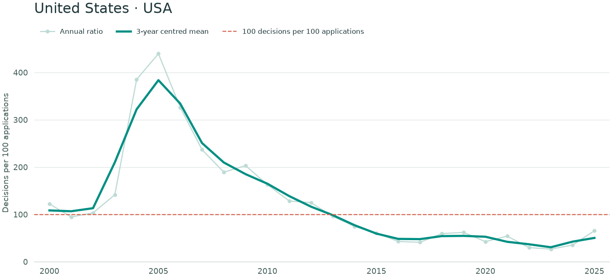{loading="lazy"}



[Open full-size chart](assets/productivity/usa.png)
:::

::: {.origin-card}
### Germany

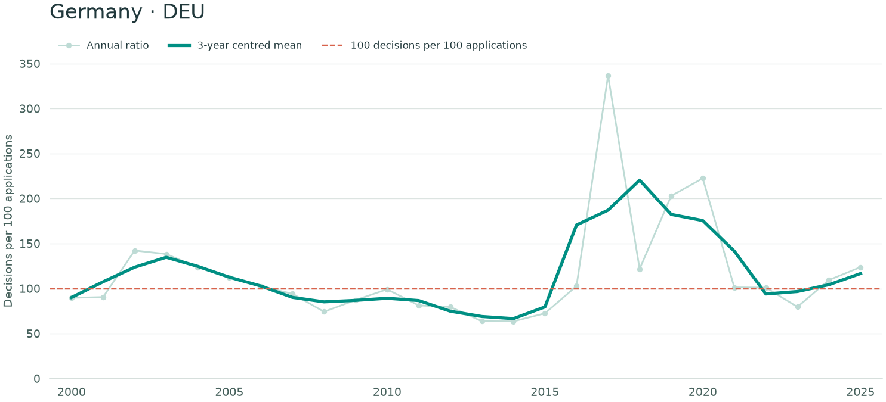{loading="lazy"}



[Open full-size chart](assets/productivity/deu.png)
:::

::: {.origin-card}
### France

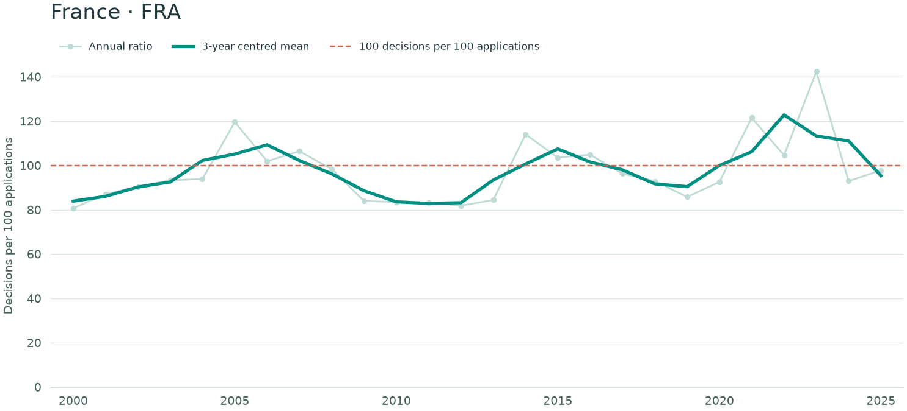{loading="lazy"}



[Open full-size chart](assets/productivity/fra.png)
:::

::: {.origin-card}
### United Kingdom

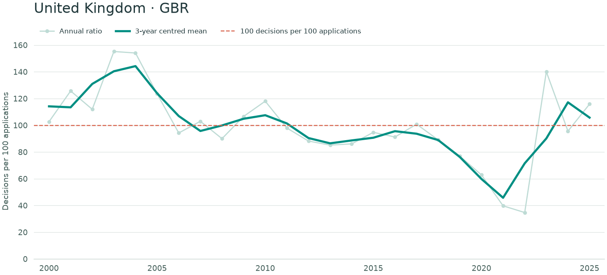{loading="lazy"}



[Open full-size chart](assets/productivity/gbr.png)
:::

::: {.origin-card}
### South Africa

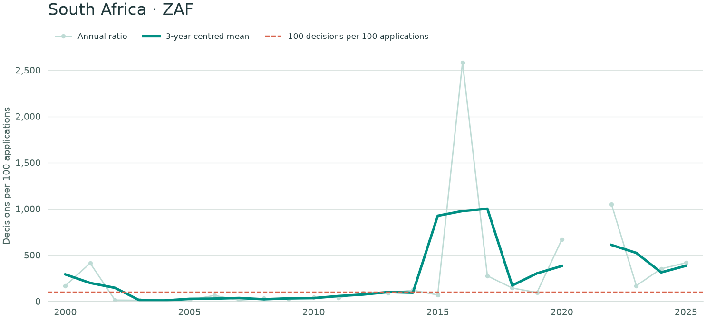{loading="lazy"}



[Open full-size chart](assets/productivity/zaf.png)
:::

::: {.origin-card}
### Italy

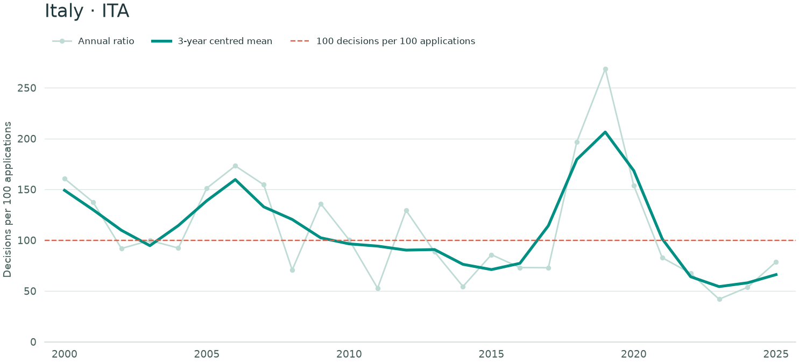{loading="lazy"}



[Open full-size chart](assets/productivity/ita.png)
:::

::: {.origin-card}
### Canada

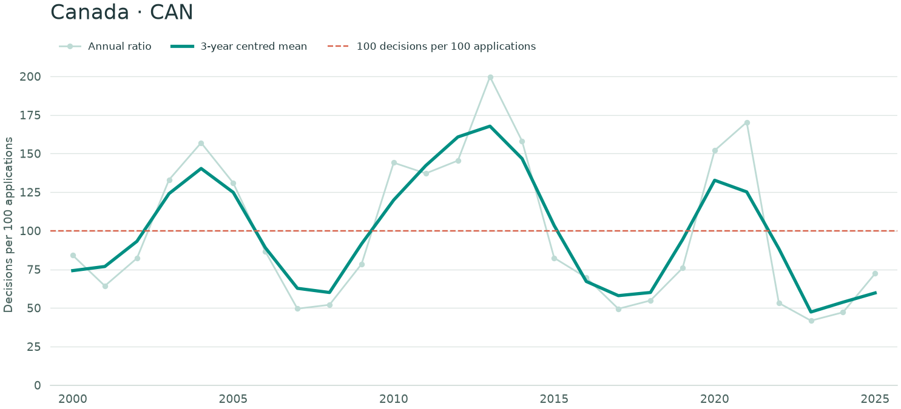{loading="lazy"}



[Open full-size chart](assets/productivity/can.png)
:::

::: {.origin-card}
### Egypt

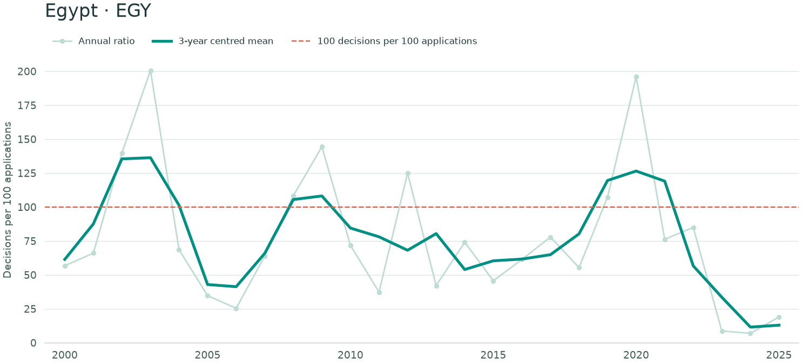{loading="lazy"}



[Open full-size chart](assets/productivity/egy.png)
:::

::: {.origin-card}
### Sweden

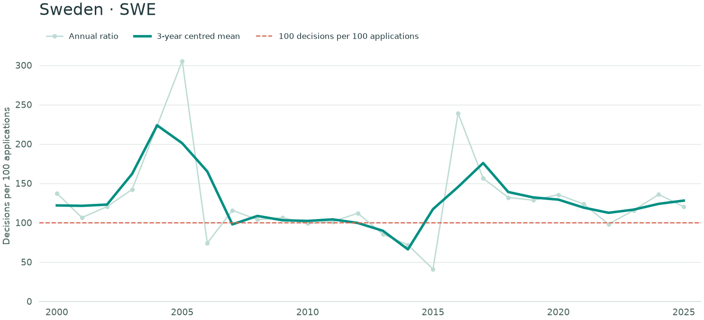{loading="lazy"}



[Open full-size chart](assets/productivity/swe.png)
:::

::: {.origin-card}
### Spain

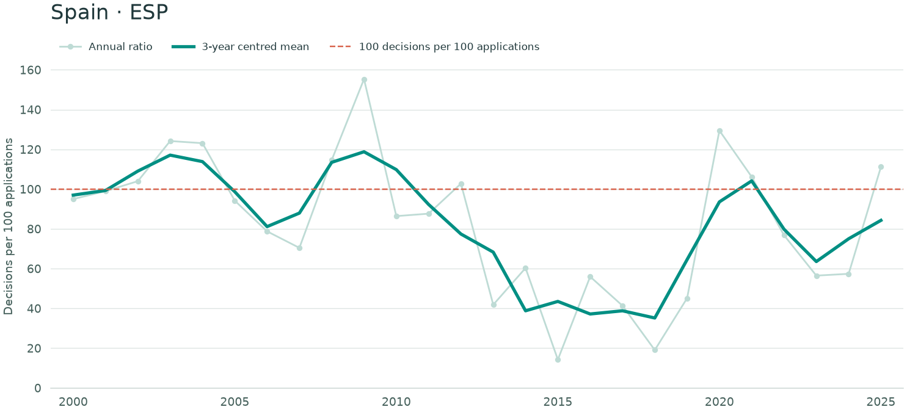{loading="lazy"}



[Open full-size chart](assets/productivity/esp.png)
:::

::: {.origin-card}
### Greece

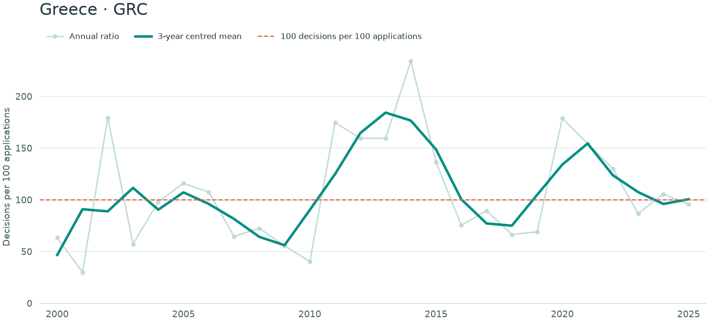{loading="lazy"}



[Open full-size chart](assets/productivity/grc.png)
:::

::: {.origin-card}
### Türkiye

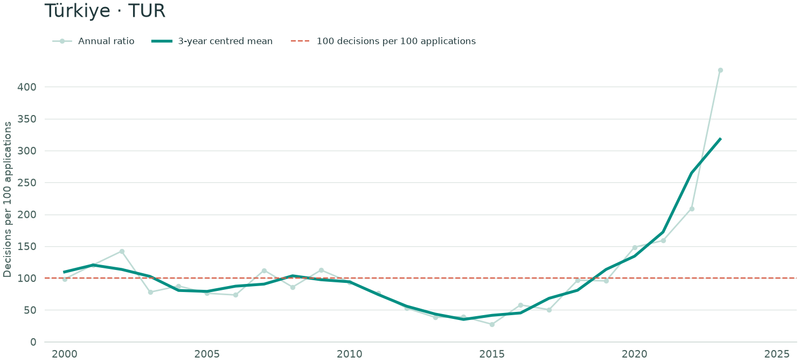{loading="lazy"}



[Open full-size chart](assets/productivity/tur.png)
:::

::: {.origin-card}
### Austria

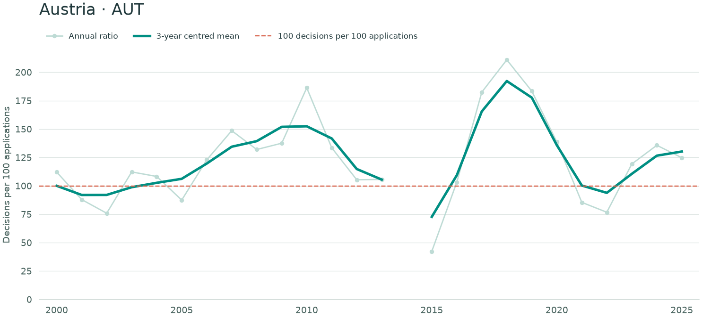{loading="lazy"}



[Open full-size chart](assets/productivity/aut.png)
:::

::: {.origin-card}
### Belgium

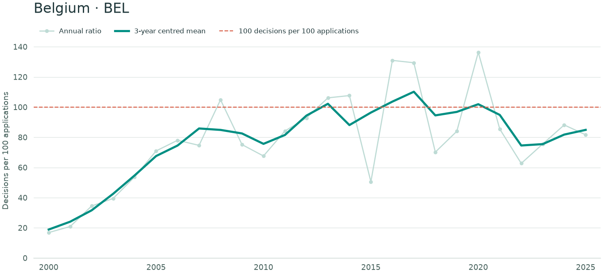{loading="lazy"}



[Open full-size chart](assets/productivity/bel.png)
:::

::: {.origin-card}
### Mexico

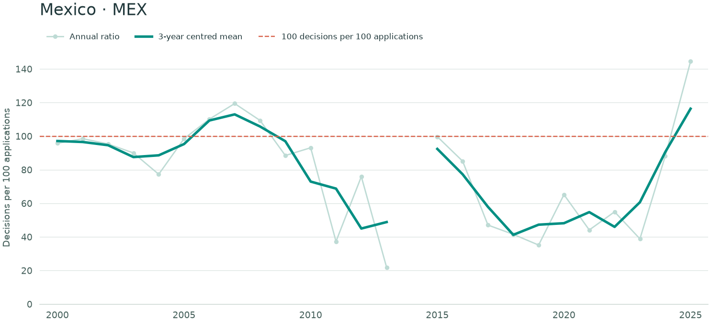{loading="lazy"}



[Open full-size chart](assets/productivity/mex.png)
:::

::: {.origin-card}
### Russian Federation

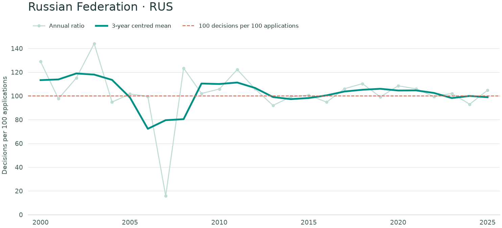{loading="lazy"}



[Open full-size chart](assets/productivity/rus.png)
:::

::: {.origin-card}
### Switzerland

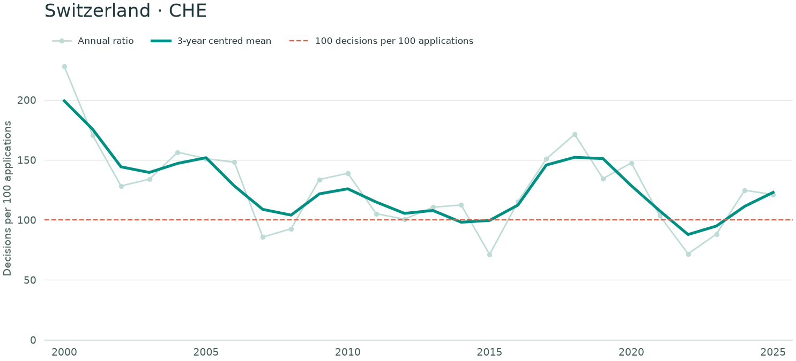{loading="lazy"}



[Open full-size chart](assets/productivity/che.png)
:::

::: {.origin-card}
### Peru

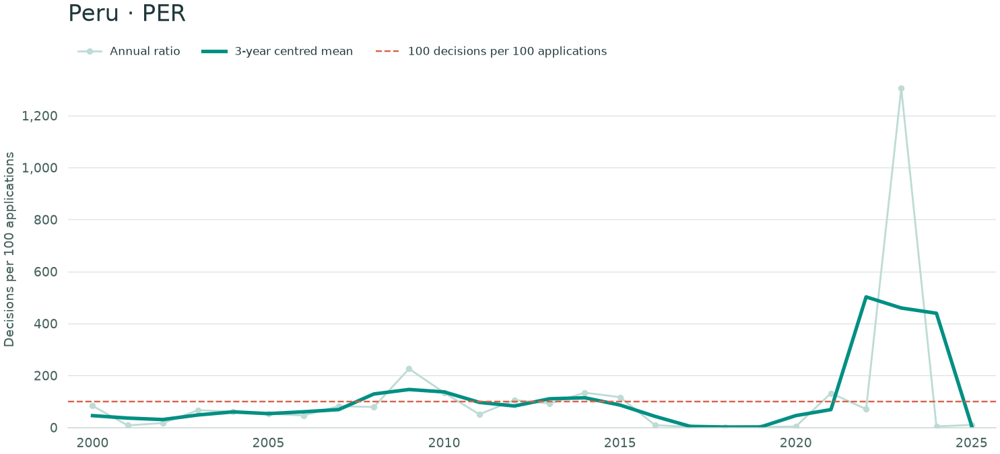{loading="lazy"}



[Open full-size chart](assets/productivity/per.png)
:::

::: {.origin-card}
### Kenya

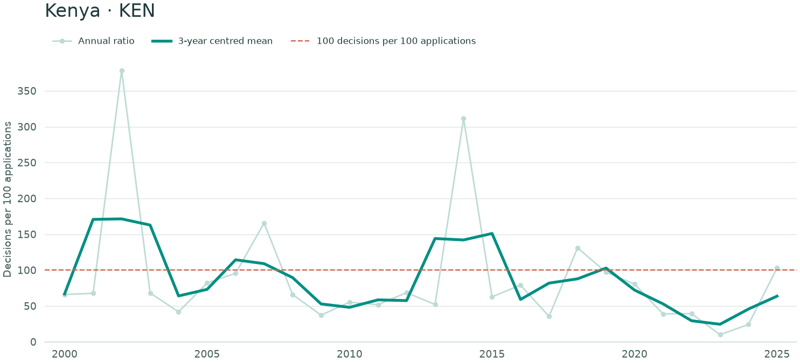{loading="lazy"}



[Open full-size chart](assets/productivity/ken.png)
:::

::: {.origin-card}
### Netherlands

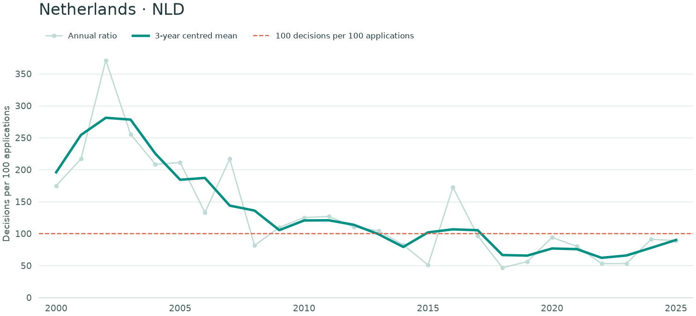{loading="lazy"}



[Open full-size chart](assets/productivity/nld.png)
:::

::::


