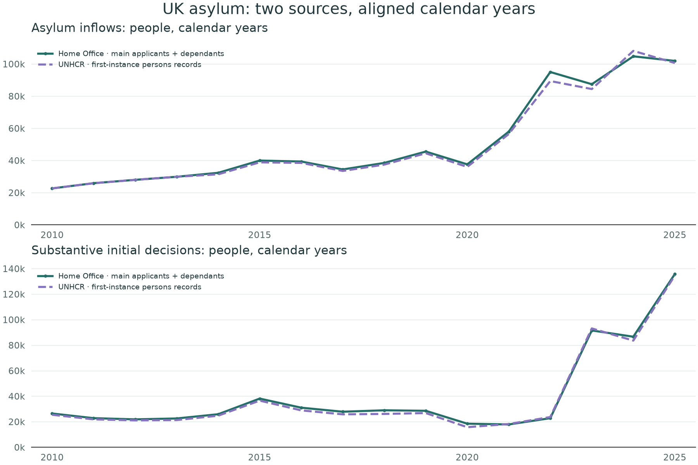
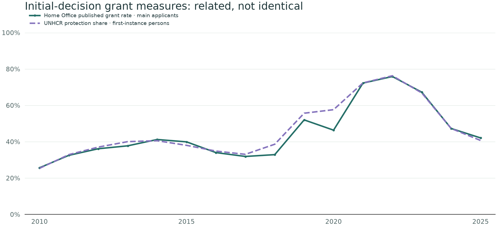

This page brings the UK's official statistics into the report without rerunning the notebook. The comparison uses **calendar years 2010–2025**, with newer UK-only information shown separately.

[Small-boat arrivals: live official figures](#small-boats) | [Small-boat grant rates by nationality](#small-boat-grants) ? [Rwanda: asylum activity and the former UK partnership](#rwanda) ? [UK activity per 100,000 residents](population.html?country=GBR).





Source: Home Office [asylum summary tables, year ending June 2026](https://www.gov.uk/government/statistical-data-sets/immigration-system-statistics-data-tables), table **Asy_00a**, published 27 August 2026. The workbook's Notes sheet defines units and denominators. [Official explanation of initial grant rates](https://www.gov.uk/government/statistics/immigration-system-statistics-year-ending-june-2026/how-many-people-are-granted-asylum-in-the-uk).

## Match the period and the measure first

This comparison deliberately uses UNHCR **first-instance (FI), persons-reported (P)** rows for the UK, rather than the combined-unit, all-procedure totals elsewhere in the report. Appeals and other stages are excluded. The Home Office separates initial decisions from withdrawals and other administrative outcomes; the UNHCR comparison decision count therefore sums refugee recognition, complementary protection, and rejection, excluding closures.

| Measure | Home Office | UNHCR comparison |
|---|---|---|
| Inflows | People claiming asylum, including dependants | First-instance application records reported as persons |
| Substantive decision volume | Initial grants and refusals, including dependants | First-instance recognised + other protection + rejected, reported as persons |
| Grant percentage | Published rate for main applicants: protection **or other leave**, excluding withdrawals and administrative outcomes | (Recognised + complementary protection) / (recognised + complementary protection + rejected), in persons-reported FI records |
| Pending headline | People awaiting an **initial** decision at the reporting date | The worldwide stock elsewhere in the report has a different geographic and procedural scope |

The rate definitions still differ: applicant coverage and the treatment of other leave are not fully harmonised. Counts can differ through revisions, reporting scope, and timing. Differences are a prompt to investigate, not evidence that either source is wrong. No gap between these lines is labelled an error or interpreted as a policy effect.

## Application and substantive decision volumes

{fig-alt="Two panels compare calendar-year UK inflows and substantive initial-decision counts from Home Office and UNHCR persons-reported first-instance records."}

Each series counts activity in the year of the event. Decisions may relate to claims made earlier; these are not matched application cohorts. Unlike the international combined-unit charts, this comparison retains a persons-only scope to avoid adding case counts to people.

## Grant proportions, with closures removed

{fig-alt="Two related initial-decision grant measures plotted on a common zero-to-100-percent scale; the sources use different applicant coverage and outcome definitions."}

The published UK rate is taken directly from the official table. It is **not reconstructed by dividing grants including dependants by decisions including dependants**. That would answer a different question. The UNHCR rate is calculated from its own first-instance outcome counts, with no closure outcomes in the denominator.





## Values and reproducible sources

```{ojs}
//| echo: false
//| output: false
uk = FileAttachment("data/uk/comparison.json").json()
```

```{ojs}
//| echo: false
Inputs.table(uk.calendar_years,{
 columns:["year","ho_claimants_people","unhcr_first_instance_applications_persons","ho_initial_decisions_people","unhcr_fi_substantive_decisions_persons","ho_published_grant_rate_main_applicants","unhcr_fi_protection_share_persons"],
 header:{year:"Year",ho_claimants_people:"HO claimants (people)",unhcr_first_instance_applications_persons:"UNHCR FI applications (P)",ho_initial_decisions_people:"HO initial decisions (people)",unhcr_fi_substantive_decisions_persons:"UNHCR FI substantive (P)",ho_published_grant_rate_main_applicants:"HO published rate (main applicants)",unhcr_fi_protection_share_persons:"UNHCR FI protection share (P)"},
 format:{year:String,ho_published_grant_rate_main_applicants:d=>d==null?"Unavailable":Math.round(d*100)+"%",unhcr_fi_protection_share_persons:d=>d==null?"Unavailable":Math.round(d*100)+"%"},rows:16
})
```

- [Exact Home Office source workbook (ODS)](data/uk/asylum-summary-jun-2026.ods)
- [Annual comparison and full-precision rates (CSV)](data/uk/annual-comparison.csv)
- [Saved retrieval URL, date and SHA-256](data/uk/source.json)
- [Parsed comparison and metadata (JSON)](data/uk/comparison.json)

The UK workbook is a dated, saved snapshot. The UNHCR inputs are the same pinned files used for the fixed 2000–2025 analysis; their hashes are recorded on [Methods & sources](methods.qmd). Official statistics may revise earlier years. Refreshing this page is a separate, deliberate step; rendering it does not contact the Home Office or execute the notebook.
