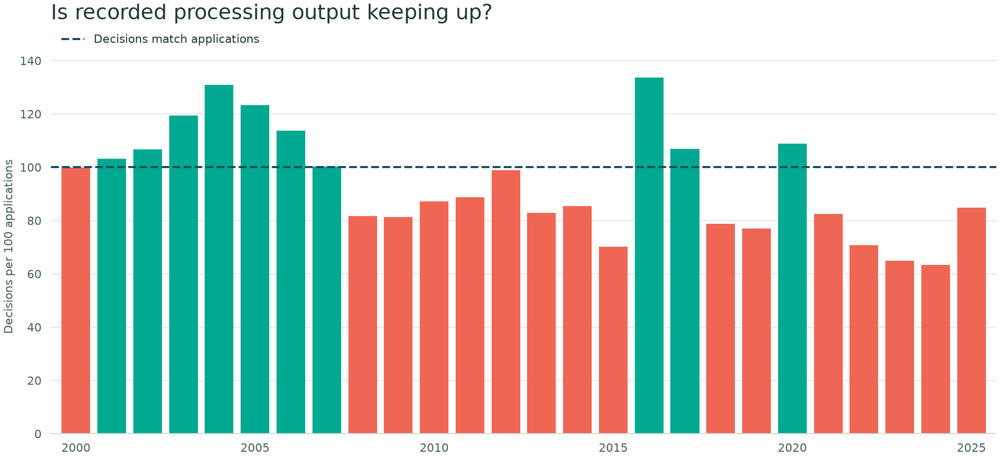
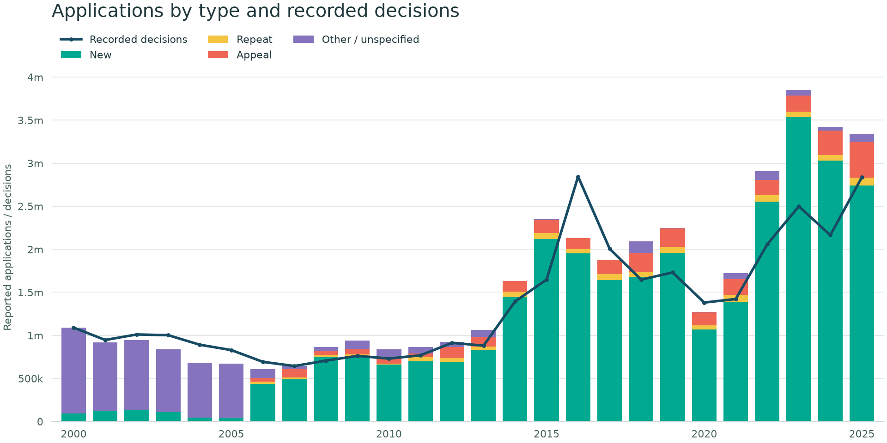
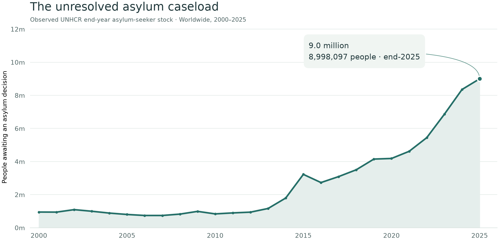
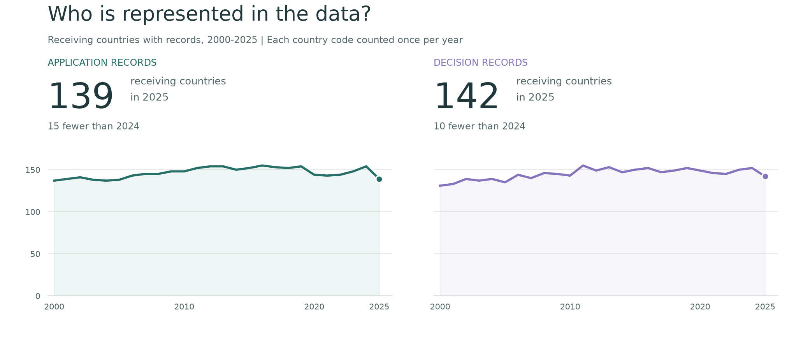

::: {.eyebrow}
Worldwide trends · Processing pressure · 2000–2025
:::

::: {.lead}
When applications arrive faster than decisions are recorded, asylum systems face sustained processing pressure. This report examines the volume coming in, the decisions coming out, and the unresolved caseload observed at year end.
:::

The central question is **whether recorded processing output is keeping up with reported applications**. Compare worldwide trends here, then explore national patterns on the [Processing Productivity page](productivity.qmd).





::: {.reading-note}
**What applications means here.** Application and decision figures combine original persons- and case-reported values without conversion. These are reported activities, not unique people or harmonised counts of cases. Applications include new claims, repeats, appeals, and other or unspecified types. Different reporting units and coverage affect comparisons.
:::

**Explore the coloured country profiles:** [Origins & destinations](origins.qmd) features the Top 20 reported origins by application volume (2000-2025), plus a dropdown for all recorded origins.

**Choose a receiving country:** [Open the interactive country explorer](explore.qmd) for applications, decisions, source downloads, and its latest refresh date.



## Is processing output keeping up? {#productivity}



{fig-alt="Annual decisions per 100 applications with a reference line at 100. Coral bars fall below 100; teal bars reach or exceed 100." fig-cap="Below 100 means fewer decisions than applications were recorded. Both flows combine persons and cases without conversion. The ratio measures recorded output relative to inflow, not staff productivity, waiting times, or decision quality."}

Repeated years with lower recorded output than inflow signal processing pressure. Differences in reporting coverage, units, and procedures mean these figures alone cannot establish a reconciled backlog. Decisions may concern applications lodged in earlier years.

## 1. Applications and decisions follow different timelines {#applications}



The bars separate application types, while the blue decisions line shows the volume recorded in the same year. They do not link the people applying with the people receiving decisions. A claim filed in one year may be decided in another.

{fig-alt="Worldwide reported applications by type alongside annual recorded decisions, from 2000 to 2025." #fig-flows fig-cap="Applications and decisions are annual flows, not matched cohorts. Application bars include new, repeat, appeal, and other or unspecified types. Persons and cases combined without conversion; source coverage varies over time."}

::: {.takeaway}
**What to take from this:** compare the flows, but avoid describing their ratio as a success rate, a waiting time, or a measure of processing efficiency.
:::

## 2. A decision does not always mean recognition {#outcomes}

The source distinguishes recognised refugee status, complementary protection, rejection, and administrative closure. Looking only at recognised decisions would leave out substantial parts of what asylum authorities record.

The next chart shows how decision composition changes by year. Each ring describes that year's decisions, rather than the eventual outcomes of applications lodged that year.





::: {.callout-note title="Two denominators, two questions"}
The **recognised share of all decisions** includes administrative closures in the denominator. UNHCR's **refugee recognition rate** uses substantive decisions and excludes those closures. A percentage calculated one way should not be labelled as the other. [See the definitions and formulae](methods.qmd#decision-rates).
:::

## 3. What remains unresolved? {#pending}

Subtracting annual decisions from applications can be tempting. But the result is a difference between flows—not a count of unresolved claims.

Here we use UNHCR's **observed end-year asylum-seeker stock**, reported in persons. This retains its original population unit; it is not an application count. This is a separate population series, reported at a date. It is not reconstructed by adding up the gaps between the bars in the first figure.

{fig-alt="Observed UNHCR worldwide end-year asylum-seeker stocks, reported in persons from 2000 to 2025." #fig-pending fig-cap="Observed UNHCR worldwide annual population-API totals, retrieved 5 November 2026. End-2025: 8,998,097 persons, matching the headline. Coverage and revisions may affect historical totals. This stock is a separate population measure from the combined application and decision flows."}

::: {.takeaway}
**What to take from this:** use observed stocks when asking how many claims are pending. Annual applications minus decisions cannot establish a reconciled backlog, and these data do not provide individual waiting times.
:::

## Before interpreting the latest year, check who reported {#coverage}

A worldwide sum can change because of the records available, as well as because of underlying events. One practical check is to count receiving-country codes represented in each year's data.



{fig-alt="Number of receiving-country codes with reported application and decision records in each year." #fig-coverage fig-cap="Each receiving-country code is counted once per year when it has any application or decision records. All reporting units are included; a zero-volume record still counts. These are counts of represented countries, not counts of applications or people. Reporting presence does not establish complete annual returns."}

This does not tell us which explanation accounts for a change in volume. It does tell us why a lower recorded total should not automatically become a claim that worldwide demand has fallen by the same proportion.

## Understanding processing pressure {#conclusion}

The processing story has three parts: incoming applications, recorded decision output, and the separately observed unresolved caseload:

- **Applications:** how many application events were recorded, and of which types?
- **Decisions:** what outcomes did reporting authorities record?
- **Pending claims:** what unresolved stock was observed at the reporting date?

They do not, by themselves, explain national policy differences, measure an applicant's chance of recognition, or establish how long people wait.

::: {.report-end}
**Go further:** [Read the methods and sources](methods.qmd), inspect the [full analysis notebook](https://github.com/aloysius109/python-charts/blob/main/UNHCRData.ipynb), or explore [UNHCR's methodology](https://www.unhcr.org/refugee-statistics/methodology).

This is an independent analysis, not an official UNHCR publication. Figures describe the saved extracts and observed stock data used for this edition.
:::
